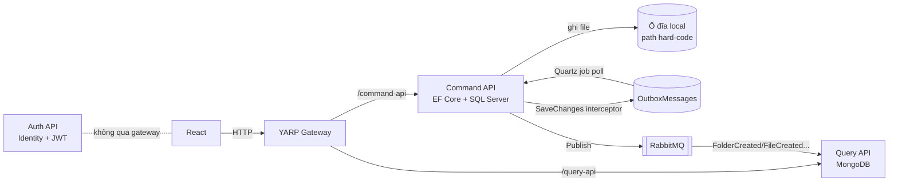

# 01 — Hiện trạng project (đánh giá ngày 06/11/2026)

> Tài liệu này mô tả **code đang có** trong repo, những gì dùng lại được, và các lỗi/rủi ro cần xử lý trước khi phát triển tiếp.
> Kiến trúc mục tiêu xem [02-kien-truc-tong-the.md](02-kien-truc-tong-the.md).

## 1. Tổng quan

| Hạng mục | Hiện trạng |
|---|---|
| Backend | .NET 8, `BackEnd/BackEnd.sln` (17 project) — **build thành công**, 0 error, 113 warning |
| Frontend | React 18 + Create React App + MUI + SCSS (`FrontEnd/my-drive`) — mới có khung layout |
| Kiểu kiến trúc | Microservice + CQRS tách 2 service (Command / Query), Clean Architecture trong từng service |
| Messaging | MassTransit 8 + RabbitMQ, outbox tự viết (bảng `OutboxMessages` + Quartz job) |
| Gateway | YARP 2.1 — route `command-api/*` và `query-api/*`, phần JWT đang bị comment |
| DB | SQL Server LocalDB (Command + Auth **dùng chung** catalog `MyDrive`), MongoDB (Query) |
| Cache | Redis (đăng ký nhưng chưa dùng) |
| Lưu file | Ghi xuống ổ đĩa local với **đường dẫn hard-code** `D:\TestProJects\AppDrive\...` |
| Test / CI / Docker | Chưa có test, chưa có CI, chưa có Dockerfile; compose chỉ có RabbitMQ |

## 2. Cấu trúc hiện tại

```
BackEnd/src
├── BuidingBlocks/
│   ├── MyDrive.BuidingBlock.Contract   # Result/Error, ICommand/IQuery (MediatR), DomainEvent, Command/Query/Response record
│   └── MyDriver.BuildBlock.FTP         # static FileService: ghi/đọc/xoá file trên đĩa
├── ReverseProxy/ApiGateway             # YARP
└── Services/
    ├── Auth/Auth.Api                   # ASP.NET Core Identity + JWT HS256 (1 project, controller)
    ├── Commands/MyDrive.Command.*      # Api, Application, Domain, Infrastructure, Persistence, Presentation
    └── Queries/MyDrive.Query.*         # Api, Application, Domain, Infrastructure, Persistence, Presentation
```

### Luồng dữ liệu hiện tại



## 3. Những gì làm tốt, nên giữ lại

- **Clean Architecture + MediatR pipeline** (Validation, Transaction, Performance, Tracing behaviors) — cấu trúc rõ ràng.
- **Domain events + Outbox pattern** — đúng hướng để đảm bảo DB và message bus nhất quán.
- **Consumer có kiểm tra idempotent** bằng `EventProjection` (dù cách làm chưa an toàn, xem bên dưới).
- **MassTransit** đã cấu hình retry, kebab-case naming, observer logging.
- **Result pattern** (`Result`, `Result<T>`, `Error`) + `ExceptionHandlingMiddleware` trả lỗi dạng ProblemDetails.
- **Carter + API versioning + Swagger** cho Minimal API.
- **YARP** làm gateway — nhẹ, cùng stack .NET, hỗ trợ WebSocket/gRPC.

## 4. Lỗi & rủi ro cần xử lý

### 4.1 Nghiêm trọng (bảo mật / mất dữ liệu)

| # | Vị trí | Vấn đề | Hướng xử lý |
|---|---|---|---|
| S1 | `ApiGateway/Program.cs`, các `FileApi`/`FolderApi` | Không có endpoint nào yêu cầu xác thực (`UseAuthentication` và `RequireAuthorization` đều bị comment). Ai cũng đọc/xoá được mọi file. | Bật JWT ở gateway **và** ở từng service. |
| S2 | Toàn bộ domain | **Không có khái niệm chủ sở hữu**. `UpdateAuditableEntitiesInterceptor` gán `CreatedBy = Guid.NewGuid()` (ngẫu nhiên). `GetFoldersQuery` trả về folder của **tất cả** user. | Thêm `OwnerId` lấy từ JWT (`ICurrentUser`), lọc mọi truy vấn theo quyền. |
| S3 | `appsettings*.json` (Gateway, Auth, Command) | JWT `SecretKey` commit lên git, dùng chung HS256 cho mọi service. | Chuyển RS256 + JWKS, secret lấy từ user-secrets/env/Vault; **rotate key đã lộ**. |
| S4 | `TypeNameHandlingConverter(TypeNameHandling.Objects)` trên bus MassTransit | Newtonsoft `TypeNameHandling` trên dữ liệu nhận từ broker là lỗ hổng *insecure deserialization* kinh điển. | Dùng System.Text.Json mặc định của MassTransit, message là record cụ thể, không polymorphic. |
| S5 | `FileService.WriteFile/DeleteFile` | Đường dẫn tuyệt đối hard-code, `DownloadFile` dùng đường dẫn **khác** (`Upload\Files`) → download không bao giờ đúng file. Không giới hạn kích thước, không kiểm tra loại file. | Thay bằng Storage Service + object storage (MinIO/S3). |
| S6 | `UpdateFileCommandHandler` | Gán `StoredName = ""` khi update → **mất liên kết tới file vật lý**. | Tách metadata update khỏi nội dung; nội dung đổi = tạo version mới. |
| S7 | `DeleteFileCommandHandler`, `UpdateFileCommandHandler` | Check null bị comment → `NullReferenceException` (500) khi id không tồn tại. Xoá DB nhưng **không xoá file vật lý**. | Trả 404; xoá mềm (thùng rác) + dọn blob bất đồng bộ. |
| S8 | `AccoutService.Register` | `_mapper.Map(registerRequest, user)` với `user == null` → kết quả map bị bỏ đi, `CreateAsync(null)` → crash. Đăng ký **không hoạt động**. | `var user = _mapper.Map<AppUser>(request)`, kiểm tra `IdentityResult`. |
| S9 | `AccoutService.Login` | Thông báo lỗi lộ việc user có tồn tại hay không; role hard-code `"Senior Leader"`; refresh token không lưu → không thể refresh; `DateTime.Now` thay vì UTC. | Thông báo lỗi chung, lưu refresh token (hash) + rotation. |
| S10 | `DeleteFolderCommandHandler` | Xoá folder không xử lý folder con / file con (FK sẽ chặn hoặc để rác). | Xoá mềm cả cây con theo materialized path. |

### 4.2 Hiệu năng / độ tin cậy

| # | Vị trí | Vấn đề |
|---|---|---|
| R1 | `AddQuartzInfrastructure` | `TimeSpan.FromMicroseconds(100)` = poll DB **10.000 lần/giây**. Ý định có lẽ là 100 ms. |
| R2 | `ProcessOutboxMessagesJob` | `switch` hard-code từng loại event; lỗi publish chỉ ghi `Error` rồi bỏ qua mãi mãi (không retry có kiểm soát). → Dùng **MassTransit Transactional Outbox** có sẵn. |
| R3 | `Consumer<TMessage>` (Query) | Idempotency "find rồi insert" không atomic, ghi `EventProjection` **sau** khi xử lý → crash giữa chừng sẽ xử lý lại; 2 consumer song song cùng xử lý. → Unique index trên `EventId` hoặc MassTransit inbox. |
| R4 | `MongoRepository` | `new MongoClient(...)` mỗi lần khởi tạo repository (nên singleton); bọc `Task.Run` quanh API async; `DeleteByIdAsync` không `await` (fire-and-forget). |
| R5 | `FileUpdated` projection | Không cập nhật `Size`, `Type`, `StoredName` → read model lệch. |
| R6 | Đọc-sau-ghi | Tạo folder xong gọi list ngay có thể chưa thấy (eventual consistency giữa Command → Query) — trải nghiệm kiểu Drive rất dễ lộ vấn đề này. |
| R7 | Upload | `IFormFile` buffer toàn bộ file qua Command API; download `ReadAllBytesAsync` load cả file vào RAM. Không chịu được file lớn. |
| R8 | EF | `EnableSensitiveDataLogging(true)` bật cả production; `UseLazyLoadingProxies` dễ gây N+1. |
| R9 | `File.Size` | Kiểu `decimal` — nên là `long` (bytes). |

### 4.3 Thiết kế / code quality

- **Contract project bị "nặng"**: `MyDrive.BuidingBlock.Contract` tham chiếu EF Core, MassTransit, AspNetCore.Http, MongoDB.Bson; command chứa `IFormFile`. Hợp đồng giữa các service phải **không phụ thuộc framework**.
- Domain event đồng thời là `ICommand` (MediatR) — trộn khái niệm *event tích hợp* với *lệnh nội bộ*.
- **Chung database** giữa Auth và Command (`Initial Catalog=MyDrive`) → vi phạm *database-per-service*.
- Validation: domain giới hạn tên 50 ký tự nhưng DB cho 200; `File` dùng `FolderFieldException`.
- Endpoint upload trả `Results.Ok("ddddddddd")`; tham số route tên `folderId` cho file.
- Lỗi chính tả trong tên project/namespace: `BuidingBlock`, `MyDriver.BuildBlock`, `UserCases`, `Asbtractions`, `AccoutService`, `recomment`.
- Auth service không đi qua gateway, không có `UseAuthentication`, không có refresh/logout endpoint.
- Frontend: login giả (`SetAccessTokenLocalStorege("token")`), chưa có API client; **Create React App đã ngừng phát triển**.
- **.NET 8 hết hạn hỗ trợ (LTS) ngày 10/11/2026** — cần nâng lên .NET 10 LTS. Máy hiện chỉ có SDK 8.0.404.

## 5. Kết luận

Nền móng (Clean Architecture, CQRS, outbox, MassTransit, YARP) đi đúng hướng và **tái sử dụng được**. Tuy nhiên phần lõi của một ứng dụng lưu trữ đám mây — **lưu trữ file, phân quyền theo người dùng, xác thực** — chưa có hoặc đang sai. Kế hoạch ở [07-ke-hoach-thuc-hien.md](07-ke-hoach-thuc-hien.md) ưu tiên sửa nền tảng (Phase 0–1) trước khi mở rộng tính năng.
