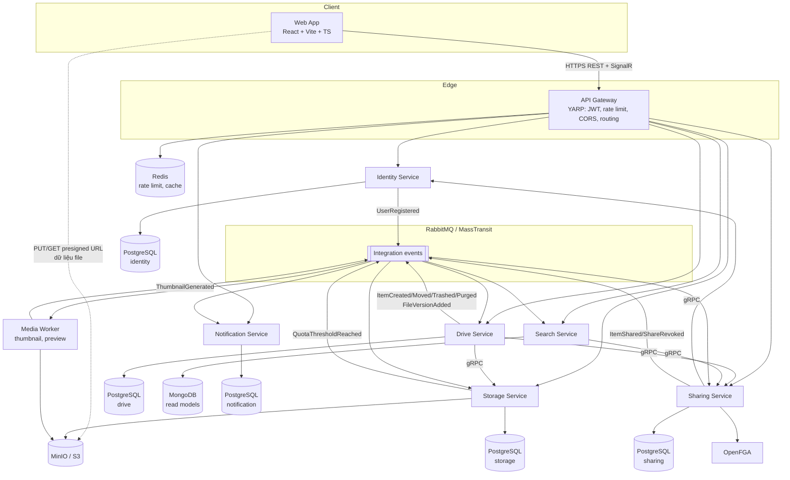

# 02 — Kiến trúc tổng thể (mục tiêu)

## 1. Mục tiêu sản phẩm

Ứng dụng lưu trữ đám mây kiểu Google Drive:

| Nhóm | Tính năng |
|---|---|
| Tài khoản | Đăng ký, đăng nhập, refresh token, đăng xuất, đổi mật khẩu, hồ sơ, avatar |
| Drive của tôi | Cây thư mục, tạo/đổi tên/di chuyển/sao chép, upload (file lớn, resume được), download, tải cả thư mục dạng zip |
| Phiên bản | Upload đè tạo version mới, xem/khôi phục version cũ |
| Thùng rác | Xoá mềm, khôi phục, xoá vĩnh viễn, tự dọn sau 30 ngày |
| Tiện ích | Gắn sao, Gần đây, Tìm kiếm (theo tên, loại, ngày, chủ sở hữu), Xem trước (ảnh/PDF/video), thumbnail |
| Chia sẻ | Chia sẻ cho user (Viewer/Commenter/Editor), link công khai (có hạn, mật khẩu), "Được chia sẻ với tôi", quyền kế thừa theo thư mục |
| Bộ nhớ | Quota theo user, thống kê dung lượng theo loại file |
| Thông báo | Email + realtime khi được chia sẻ, upload xong, sắp hết dung lượng |

**Ngoài phạm vi giai đoạn đầu**: sync client desktop, chỉnh sửa tài liệu online, mobile app native, thanh toán.

## 2. Yêu cầu phi chức năng

| Thuộc tính | Mục tiêu |
|---|---|
| Kích thước file | Tối đa 5 GB/file (multipart 8–64 MB/part), resume được khi rớt mạng |
| Băng thông | Dữ liệu file **không đi qua** service .NET — client upload/download trực tiếp object storage bằng presigned URL |
| Độ trễ | API metadata p95 < 200 ms; liệt kê thư mục 100 item p95 < 150 ms |
| Nhất quán | Thao tác trên thư mục/file của chính mình: **đọc-sau-ghi nhất quán**. Tìm kiếm, "Gần đây", thống kê: eventual (< 2 s) |
| Độ tin cậy | Không mất event (outbox), consumer idempotent, retry + dead-letter |
| Bảo mật | Mọi request xác thực JWT; kiểm tra quyền trên **từng** item; không lộ object key; quét virus (tuỳ chọn) |
| Quan sát | Trace xuyên suốt HTTP → gRPC → RabbitMQ (OpenTelemetry), log có correlation id, metrics |
| Triển khai | Chạy toàn bộ local bằng 1 lệnh (.NET Aspire hoặc docker compose); production trên Kubernetes |

## 3. Sơ đồ kiến trúc



## 4. Danh sách service

| Service | Trách nhiệm chính | Lưu trữ | Nguồn từ code cũ |
|---|---|---|---|
| **API Gateway** | Điểm vào duy nhất; xác thực JWT; rate limit; CORS; route REST + WebSocket | Redis | `ApiGateway` (giữ, bổ sung) |
| **Identity** | User, đăng nhập, refresh token, JWKS, hồ sơ | PostgreSQL | `Auth.Api` (sửa lại) |
| **Drive** | Nguồn sự thật (*source of truth*) cho metadata: item (file/folder), cây thư mục, version, thùng rác, gắn sao | PostgreSQL | `MyDrive.Command.*` (refactor) |
| **Storage** | Object storage: upload session, presigned URL, multipart, quota, dọn blob mồ côi | PostgreSQL + MinIO | `MyDriver.BuildBlock.FTP` (thay thế) |
| **Sharing** | Chia sẻ, link công khai, **kiểm tra quyền** (kế thừa theo cây) | PostgreSQL + OpenFGA | mới |
| **Search** | Read model: tìm kiếm, "Gần đây", "Được chia sẻ với tôi", hoạt động | MongoDB | `MyDrive.Query.*` (tái định hướng) |
| **Notification** | Email, thông báo in-app, realtime SignalR | PostgreSQL | mới |
| **Media Worker** | Thumbnail ảnh/video, preview PDF, (tuỳ chọn) quét virus ClamAV | — (ghi MinIO) | mới |

Chi tiết từng service: [03-dac-ta-service.md](03-dac-ta-service.md).

## 5. Nguyên tắc giao tiếp

| Loại tương tác | Cơ chế | Ví dụ |
|---|---|---|
| Client → hệ thống | REST/JSON qua Gateway (+ SignalR cho realtime) | `POST /api/drive/v1/items` |
| Service → service, **cần kết quả ngay** (query, kiểm tra, lệnh đồng bộ) | **gRPC** (HTTP/2, protobuf) | Drive → Sharing `Check(user, item, "edit")`; Drive → Storage `CompleteUpload` |
| Service → service, **thông báo việc đã xảy ra** | **Integration event** qua RabbitMQ (MassTransit), publish qua **Transactional Outbox** | `ItemTrashed` → Search cập nhật index, Sharing giữ nguyên, Notification bỏ qua |
| Dữ liệu file (byte) | Client ↔ MinIO trực tiếp bằng **presigned URL** | upload part, download |

Quy tắc:

1. **Database-per-service**: không service nào đọc DB của service khác. Cần dữ liệu → gọi gRPC hoặc tự giữ bản sao qua event.
2. **gRPC chỉ dùng cho đường đi đồng bộ ngắn** (deadline mặc định 2 s). Không tạo chuỗi gọi gRPC dài hơn 2 hop, và **đồ thị phụ thuộc gRPC không có vòng**: `Drive → {Storage, Sharing}`, `Sharing → Identity`, `Search → Sharing`. Chiều ngược lại (ví dụ Sharing cần biết cây thư mục) đi bằng event.
3. **Event là sự thật đã xảy ra** (thì quá khứ: `ItemMoved`), không phải lệnh. Event không chứa dữ liệu nhạy cảm, có `EventId`, `OccurredAt`, `Version`.
4. Mọi consumer phải **idempotent** (MassTransit inbox hoặc unique index theo `EventId`).
5. Hợp đồng (proto + event record) nằm trong project `Contracts`, **không phụ thuộc framework**, tuân thủ quy tắc tương thích ngược (chỉ thêm field; `buf breaking` chạy trong CI).

Chi tiết: [04-giao-tiep-grpc-va-event.md](04-giao-tiep-grpc-va-event.md).

## 6. Về CQRS: thay đổi so với code cũ

Code cũ tách **Command service** (SQL) và **Query service** (Mongo) cho *cùng* dữ liệu folder/file. Với Drive, cách này gây lỗi trải nghiệm: tạo thư mục xong mở ra không thấy (read model chưa kịp cập nhật — mục R6 trong hiện trạng).

Quyết định mới (chi tiết trong [ADR-003](08-adr.md#adr-003)):

- **Drive Service** giữ CQRS *bên trong* service: command qua domain model + EF Core; query liệt kê thư mục/chi tiết item đọc thẳng PostgreSQL (EF no-tracking hoặc Dapper) → **nhất quán ngay**.
- **Search Service** (từ Query service cũ) chỉ phục vụ các view **chấp nhận trễ**: full-text search, Gần đây, Được chia sẻ với tôi, Activity, thống kê. Đây là chỗ MongoDB + event projection thực sự có giá trị.

## 7. Công nghệ

| Lớp | Lựa chọn | Lý do |
|---|---|---|
| Runtime | **.NET 10 (LTS)**, C# 14 | .NET 8 hết hỗ trợ 10/11/2026 |
| Orchestration dev | **.NET Aspire** (AppHost + ServiceDefaults) | 1 lệnh chạy toàn bộ service + Postgres/RabbitMQ/Redis/MinIO/Mongo, service discovery, dashboard OpenTelemetry |
| Gateway | YARP | Đã có; hỗ trợ HTTP/2, WebSocket |
| API công khai | Minimal API + Carter + Asp.Versioning + OpenAPI | Đã có |
| RPC nội bộ | Grpc.AspNetCore, Grpc.Net.ClientFactory, Grpc.Tools | Chuẩn của .NET |
| Messaging | MassTransit **8.x** (Apache-2.0, ghim major) + RabbitMQ, **EF Core / MongoDB Transactional Outbox** | Thay outbox tự viết. Lưu ý license v9 — xem [ADR-008](08-adr.md#adr-008) |
| In-process mediator | MediatR **12.x** (ghim, Apache-2.0); bỏ AutoMapper, map thủ công | Các bản mới của MediatR/AutoMapper chuyển sang license thương mại — xem [ADR-008](08-adr.md#adr-008) |
| CSDL quan hệ | **PostgreSQL** (thay SQL Server LocalDB) | Chạy container nhẹ, miễn phí, `ltree`/recursive CTE cho cây thư mục; migration hiện tại còn ít nên chi phí chuyển thấp ([ADR-004](08-adr.md#adr-004)) |
| Read model | MongoDB | Đã có |
| Object storage | API **S3**; dev dùng MinIO (image Chainguard), self-host chốt ở Phase 2; prod có thể dùng AWS S3/R2 | Presigned URL, multipart upload — xem [ADR-011](08-adr.md#adr-011) |
| Phân quyền | **OpenFGA** (mô hình Zanzibar) | Quyền kế thừa theo cây thư mục, "list objects user có quyền" |
| Cache / rate limit | Redis | Đã có |
| Observability | OpenTelemetry → Aspire Dashboard (dev); Prometheus + Grafana + Tempo + Loki (prod) | |
| Log | Serilog (giữ) → OTLP | |
| Frontend | **React + Vite + TypeScript**, MUI, TanStack Query, React Router, Uppy (S3 multipart), SignalR client | CRA đã ngừng phát triển |
| Test | xUnit, FluentAssertions/Shouldly, Testcontainers, MassTransit Test Harness, Playwright, k6 | |
| CI/CD | GitHub Actions → GHCR → Kubernetes (Helm) | Repo đang trên GitHub |

## 8. Cấu trúc thư mục mục tiêu

```
MyCloud/
├── docs/                                  # tài liệu này
├── BackEnd/
│   ├── MyCloud.sln
│   ├── Directory.Build.props              # TargetFramework, Nullable, TreatWarningsAsErrors...
│   ├── Directory.Packages.props           # Central Package Management
│   ├── src/
│   │   ├── Aspire/
│   │   │   ├── MyCloud.AppHost/           # khai báo toàn bộ service + hạ tầng
│   │   │   └── MyCloud.ServiceDefaults/   # OTel, health check, resilience, service discovery
│   │   ├── BuildingBlocks/
│   │   │   ├── MyCloud.BuildingBlocks.Domain/        # Entity, AggregateRoot, ValueObject, Result, Error
│   │   │   ├── MyCloud.BuildingBlocks.Application/   # MediatR behaviors, ICurrentUser, paging
│   │   │   ├── MyCloud.BuildingBlocks.Messaging/     # cấu hình MassTransit chuẩn + outbox
│   │   │   ├── MyCloud.BuildingBlocks.Grpc/          # interceptor (auth, exception→status, logging)
│   │   │   └── MyCloud.BuildingBlocks.Web/           # JWT, ProblemDetails, Carter, versioning
│   │   ├── Contracts/
│   │   │   ├── MyCloud.Contracts.Protos/             # *.proto (+ buf.yaml)
│   │   │   └── MyCloud.Contracts.Events/             # record event, KHÔNG phụ thuộc framework
│   │   ├── Gateway/MyCloud.Gateway/
│   │   └── Services/
│   │       ├── Identity/   Identity.Api | Identity.Application | Identity.Domain | Identity.Infrastructure
│   │       ├── Drive/      Drive.Api    | Drive.Application    | Drive.Domain    | Drive.Infrastructure
│   │       ├── Storage/    Storage.Api        (1 project, vertical slice)
│   │       ├── Sharing/    Sharing.Api        (1 project, vertical slice)
│   │       ├── Search/     Search.Api         (1 project)
│   │       ├── Notification/ Notification.Api (1 project)
│   │       └── Media/      Media.Worker       (Worker service)
│   └── tests/
│       ├── Drive.Domain.Tests/ ...
│       ├── Drive.IntegrationTests/ ...       # Testcontainers
│       └── Architecture.Tests/               # NetArchTest: cấm tham chiếu chéo service
├── FrontEnd/web/                              # Vite + React + TS
├── deploy/
│   ├── docker-compose.yml                     # chạy không cần Aspire
│   └── helm/                                  # chart cho K8s
└── .github/workflows/
```

Quy ước:
- Service có domain phức tạp (**Identity, Drive**) giữ Clean Architecture **4 project** (gộp `Persistence` vào `Infrastructure`, `Presentation` vào `Api` so với code cũ — bớt 2 project/service mà không mất tách lớp).
- Service nhỏ (**Storage, Sharing, Search, Notification, Media**) dùng **1 project, tổ chức theo vertical slice** (`Features/CreateUploadSession/...`).
- Sửa toàn bộ lỗi chính tả tên project/namespace khi tái cấu trúc.
