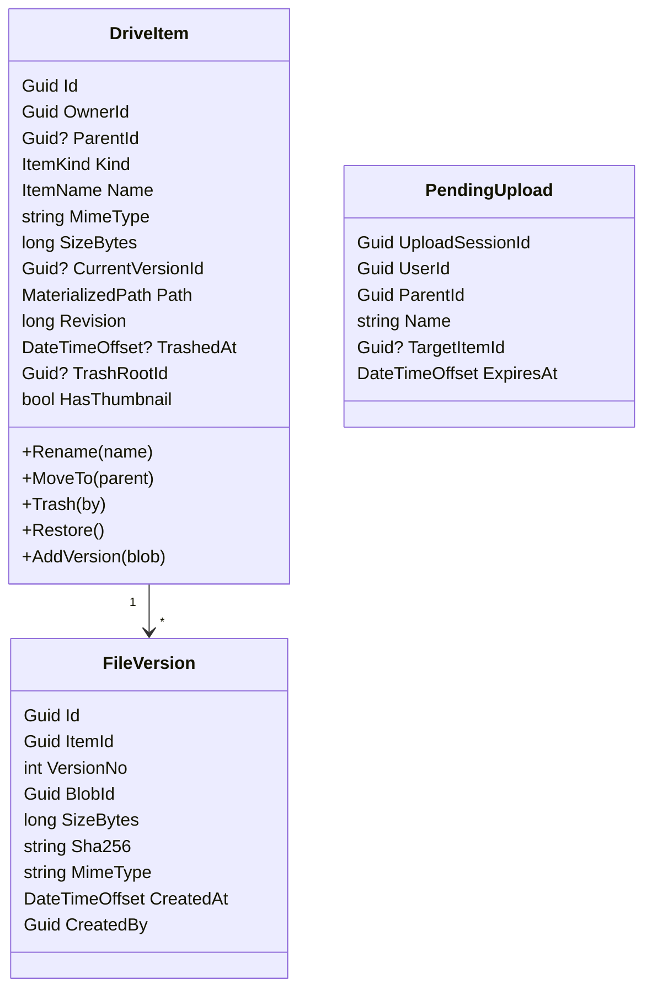

# 03 — Đặc tả từng service

Quy ước chung cho mọi service:

- REST công khai map dưới `/api/v{n}/...` trong service; Gateway expose dạng `/api/{service}/v{n}/...` (ví dụ `/api/drive/v1/items/{id}`) và rewrite path.
- Mỗi service mở **2 endpoint Kestrel**: `http` (HTTP/1.1 + HTTP/2) cho REST/health, `grpc` (**HTTP/2-only**) cho gRPC nội bộ — bắt buộc khi chạy h2c không TLS trong mạng nội bộ.
- Health check: `/health/live`, `/health/ready` (kiểm tra DB, RabbitMQ).
- Lỗi REST: `application/problem+json` (RFC 9457). Lỗi gRPC: `StatusCode` chuẩn + `google.rpc.ErrorInfo` với `reason` dạng `DRIVE.ITEM_NOT_FOUND`.
- Định danh: `Guid` v7 (`Guid.CreateVersion7()`) — có thứ tự thời gian, tốt cho index.
- Thời gian: `DateTimeOffset` UTC, inject `TimeProvider` để test được.
- Phân trang: cursor (`pageToken`, `pageSize` ≤ 200), không dùng offset cho danh sách lớn.

---

## 1. API Gateway (`MyCloud.Gateway`)

**Trách nhiệm**: điểm vào duy nhất cho client.

| Chức năng | Chi tiết |
|---|---|
| Routing | YARP, cấu hình qua `appsettings` + service discovery (Aspire/K8s DNS). Route `/api/{service}/**`, `/hubs/notifications` (WebSocket) |
| Xác thực | Validate JWT (RS256) bằng JWKS của Identity. Route công khai: `/api/identity/v1/auth/*`, `/api/sharing/v1/links/{token}` (anonymous). Còn lại `RequireAuthorization` |
| Rate limit | `Microsoft.AspNetCore.RateLimiting`: login 5 req/phút/IP, API chung 100 req/s/user; dùng Redis nếu chạy nhiều instance |
| CORS | Chỉ cho origin của web app (cấu hình), **không** `*` |
| Header | Sinh/forward `X-Correlation-Id`, forward `Authorization`, xoá header nội bộ từ client (`X-User-Id`...) |
| Giới hạn | Body tối đa 1 MB (file không đi qua gateway) |

Không chứa logic nghiệp vụ, không gọi gRPC.

---

## 2. Identity Service

**Trách nhiệm**: quản lý tài khoản và phát hành token.

### REST (công khai)
| Method | Path | Mô tả |
|---|---|---|
| POST | `/auth/register` | `{email, password, displayName}` → 201. Publish `UserRegistered` |
| POST | `/auth/login` | `{email, password}` → `{accessToken, expiresIn}` + refresh token trong cookie `HttpOnly` (client không phải trình duyệt nhận trong body) |
| POST | `/auth/refresh` | Đọc refresh token từ cookie (hoặc body) → cặp token mới (rotation) |
| POST | `/auth/logout` | Thu hồi refresh token family |
| GET/PATCH | `/users/me` | Hồ sơ, đổi tên hiển thị, avatar |
| POST | `/users/me/password` | Đổi mật khẩu → thu hồi mọi refresh token |
| GET | `/users/lookup?email=` | Tra **chính xác** 1 email (cho hộp thoại chia sẻ), rate-limit chặt để chống dò email |
| GET | `/users:batchGet?ids=` | Tên + avatar cho danh sách user (hiển thị "Chủ sở hữu", "Sửa đổi bởi") |
| GET | `/.well-known/jwks.json` | Public key để Gateway/service validate token |

Phase sau: xác minh email, quên mật khẩu, đăng nhập Google (OIDC), 2FA TOTP.

### gRPC (`identity.v1.UserService`)
`GetUser`, `BatchGetUsers`, `FindUserByEmail` — dùng bởi Sharing.

### Event
- Publish: `UserRegistered`, `UserProfileChanged`, (sau) `UserDeleted`.

### Dữ liệu (PostgreSQL `identity`)
- Bảng ASP.NET Core Identity (`users`, `roles`, `user_roles`, `user_claims`...). Rút gọn `AppUser`: bỏ `IsDirector`, `PositionId`, `ManagerId`... (thừa hưởng từ project HR, không thuộc Drive).
- `refresh_tokens(id, user_id, token_hash, family_id, expires_at, revoked_at, replaced_by_id, created_at, ip, user_agent)`.
- `signing_keys` (hoặc Data Protection/Key Vault) — hỗ trợ xoay vòng key, JWKS trả cả key cũ còn hiệu lực.

### Token
- Access token: JWT **RS256**, 15 phút, claim: `sub` (userId), `email`, `name`, `jti`, `scope`. Không nhét quyền theo file vào token.
- Refresh token: chuỗi ngẫu nhiên 256-bit, lưu **hash SHA-256**, 30 ngày, *rotation* — dùng lại token cũ ⇒ thu hồi cả family (phát hiện bị đánh cắp).

---

## 3. Drive Service (trung tâm)

**Trách nhiệm**: nguồn sự thật cho metadata của file/thư mục, cây thư mục, version, thùng rác, gắn sao. Điều phối upload/download (nhưng không chạm vào byte của file).

### Mô hình domain

Thay `Folder` + `File` tách rời bằng **một aggregate `DriveItem`** (giống Google Drive: thư mục là item có `kind = Folder`). Lý do: liệt kê, sắp xếp, phân trang, di chuyển, xoá, chia sẻ đều áp dụng chung cho cả hai ([ADR-005](08-adr.md#adr-005)).



Bất biến (invariant):
- Mỗi user có đúng 1 item gốc "Drive của tôi" (`ParentId = null`, `IsRoot`), tạo khi nhận `UserRegistered`.
- Tên: 1–255 ký tự, không chứa `/`, `\`, ký tự điều khiển; **không trùng tên (không phân biệt hoa thường) trong cùng thư mục** với item chưa bị xoá. Upload trùng tên ⇒ tự đổi `report (1).pdf` hoặc tạo version mới nếu client chọn "thay thế".
- Không di chuyển thư mục vào chính nó hoặc con cháu của nó.
- Không thao tác (trừ restore/purge) trên item đã ở thùng rác.
- Mọi thay đổi tăng `Revision` (dùng cho optimistic concurrency `If-Match` và để consumer bỏ qua event cũ).

### Dữ liệu (PostgreSQL `drive`)

```sql
items(
  id uuid pk, owner_id uuid not null, parent_id uuid null references items,
  kind smallint not null, name varchar(255) not null, name_key varchar(255) not null, -- lower + normalize NFC
  mime_type varchar(255), size_bytes bigint not null default 0,
  current_version_id uuid null, path text not null,        -- "/<rootId>/<id1>/<id2>/"
  depth int not null, is_root bool not null,
  revision bigint not null, trashed_at timestamptz null, trash_root_id uuid null, trashed_by uuid null,
  has_thumbnail bool not null default false,
  created_at, created_by, modified_at, modified_by
)
unique (parent_id, name_key) where trashed_at is null
index (parent_id, kind, name_key)          -- liệt kê thư mục: folder trước, theo tên
index (path text_pattern_ops)              -- truy vấn cây con: WHERE path LIKE '/a/b/%'
index (owner_id, trashed_at)               -- thùng rác

file_versions(id, item_id, version_no, blob_id, size_bytes, sha256, mime_type, created_at, created_by)
  unique (item_id, version_no)
stars(user_id, item_id, created_at) pk(user_id, item_id)
pending_uploads(upload_session_id pk, user_id, parent_id, name, target_item_id, expires_at)
-- + bảng outbox/inbox của MassTransit
```

Di chuyển cây con = **1 câu UPDATE** trên `path` (`SET path = :new || substr(path, length(:old)+1) WHERE path LIKE :old || '%'`).

### REST (công khai)

| Method | Path | Mô tả |
|---|---|---|
| GET | `/items/root` | Item gốc của tôi |
| GET | `/items/{id}` | Chi tiết (kèm `capabilities`: canEdit, canShare, canDownload) |
| GET | `/items/{id}/children?pageToken&pageSize&orderBy=name\|modifiedAt\|size&desc` | Nội dung thư mục — **đọc thẳng Postgres, nhất quán ngay** |
| GET | `/items/{id}/ancestors` | Breadcrumb |
| POST | `/folders` | `{parentId, name}` |
| PATCH | `/items/{id}` | Đổi tên, mô tả. Header `If-Match: "<revision>"` |
| POST | `/items/{id}:move` | `{newParentId}` |
| POST | `/items/{id}:copy` | `{targetParentId, name?}` (file: server-side copy blob; thư mục: job nền) |
| POST | `/items/{id}:trash` / `:restore` | Thùng rác |
| DELETE | `/items/{id}` | Xoá vĩnh viễn (chỉ khi đang trong thùng rác) |
| GET / DELETE | `/trash` | Danh sách / dọn sạch thùng rác |
| PUT / DELETE | `/items/{id}/star` | Gắn/bỏ sao; `GET /starred` |
| POST | `/uploads` | Khởi tạo upload: `{parentId, name, sizeBytes, mimeType, targetItemId?}` → `{uploadId, partSize, partCount, parts:[{partNumber,url}]}` |
| POST | `/uploads/{uploadId}:complete` | `{parts:[{partNumber, etag}]}` → item đã tạo |
| DELETE | `/uploads/{uploadId}` | Huỷ |
| POST | `/items/{id}:downloadUrl?versionId=` | → `{url, expiresAt}` (presigned 5 phút, `Content-Disposition: attachment; filename*=UTF-8''...`) |
| GET | `/items/{id}/thumbnail?size=256` | 302 → presigned URL thumbnail |
| GET | `/items/{id}/versions`, POST `/items/{id}/versions/{vid}:restore` | Version |
| POST | `/archives` | `{itemIds}` → job tạo zip (Phase 5), trả về qua notification |

> Vì sao `:downloadUrl` trả JSON thay vì redirect: trình duyệt không gắn được header `Authorization` khi điều hướng; frontend lấy URL rồi `window.location = url`.

### gRPC (`drive.v1.DriveQueryService`, chỉ nội bộ)
`GetItem`, `BatchGetItems`, `GetAncestors` — dùng cho tác vụ quản trị/đối soát (reconcile) và tooling. Đường đi chính của các service khác vẫn là event.

### gRPC gọi đi
- `storage.v1.StorageService`: CreateUploadSession, CompleteUpload, AbortUpload, GetDownloadUrl, CopyBlob.
- `sharing.v1.AuthorizationService`: Check / BatchCheck khi người gọi **không phải** chủ sở hữu (fast-path: `owner_id == currentUser` ⇒ không cần gọi).

### Event
- Publish (qua outbox): `ItemCreated`, `ItemRenamed`, `ItemMoved`, `ItemTrashed`, `ItemRestored`, `ItemsPurged` (kèm danh sách `blobIds`), `FileVersionAdded`, `ItemAccessed` (mở/tải — cho "Gần đây", gộp tối đa 1 event/item/user/5 phút).
- Consume: `UserRegistered` → tạo root; `ThumbnailGenerated` → `HasThumbnail = true`; `MalwareDetected` → chặn tải.

### Job nền
- Purge thùng rác > 30 ngày (theo lô 500 item).
- Dọn `pending_uploads` hết hạn.

---

## 4. Storage Service

**Trách nhiệm**: mọi thứ liên quan tới byte của file và dung lượng.

### Khái niệm
- **Blob**: 1 object trong MinIO, key ngẫu nhiên `u/{userId}/{blobId}` (không chứa tên file). Bucket **private**.
- **Upload session**: bọc một S3 multipart upload. Mọi upload đều là multipart (file nhỏ = 1 part). Part mặc định 8 MB ⇒ file 5 GB = 640 part, dưới giới hạn 10.000 part của S3; nếu sau này nâng giới hạn file, tăng part size theo công thức `ceil(size / 10000)`.
- **Quota**: `limit`, `used`, `reserved` theo user. Reserve khi tạo session, commit khi complete, release khi abort/hết hạn/GC.

Vòng đời blob: `Pending → Uploaded → Claimed → Deleting → (xoá)`.
`Uploaded` nhưng không được Drive "claim" (nhận `FileVersionAdded`) trong 24 h ⇒ GC xoá và trả quota. Cơ chế này thay cho distributed transaction giữa Drive và Storage ([ADR-006](08-adr.md#adr-006)).

### Dữ liệu (PostgreSQL `storage`)
```sql
blobs(id pk, owner_user_id, bucket, object_key, size_bytes, sha256 null, mime_type, status, created_at, claimed_at)
upload_sessions(id pk, user_id, blob_id, s3_upload_id, part_size, part_count, expected_size, status, expires_at)
quotas(user_id pk, limit_bytes, used_bytes, reserved_bytes, version)   -- UPDATE ... WHERE used+reserved+:n <= limit
```

### gRPC (`storage.v1.StorageService`)
| RPC | Gọi bởi | Mô tả |
|---|---|---|
| `CreateUploadSession` | Drive | Reserve quota, `CreateMultipartUpload`, ký URL cho các part đầu |
| `SignUploadParts` | Drive/Storage REST | Ký thêm URL part (URL hết hạn sau 1 h) |
| `CompleteUpload` | Drive | `CompleteMultipartUpload`, `HEAD` kiểm tra size, commit quota, blob → `Uploaded` |
| `AbortUpload` | Drive | Huỷ, trả quota |
| `GetDownloadUrl` | Drive | Presigned GET + `response-content-disposition` |
| `CopyBlob` | Drive | Server-side copy (sao chép file), tính quota người sao chép |
| `GetQuota` | Drive, REST | Dung lượng |

### REST (công khai)
- `GET /uploads/{sessionId}/parts?numbers=1-50` — client xin thêm URL part (kiểm tra `session.user_id == sub`).
- `GET /quota` — dung lượng đã dùng / giới hạn, breakdown theo loại (từ Search hoặc tự tính).

### Event
- Consume: `UserRegistered` → tạo quota mặc định (15 GB, cấu hình); `FileVersionAdded` → claim blob; `ItemsPurged` → xoá object, trả quota.
- Publish: `QuotaThresholdReached` (80 %, 95 %, 100 %).

### Job nền
- Hết hạn upload session (Abort + release quota).
- GC blob `Uploaded` không được claim > 24 h; blob `Deleting` xoá lỗi thì thử lại.
- Rule lifecycle của bucket: tự abort multipart chưa hoàn tất sau 7 ngày (lưới an toàn).

---

## 5. Sharing Service

**Trách nhiệm**: ai được làm gì với item nào, và chia sẻ.

### Mô hình quyền
Vai trò: `owner` > `editor` > `commenter` > `viewer`. Quyền **kế thừa xuống** thư mục con. Dùng **OpenFGA** (Zanzibar) làm engine kiểm tra quyền ([ADR-007](08-adr.md#adr-007)):

```text
model
  schema 1.1

type user
type link

type item
  relations
    define parent: [item]
    define owner: [user]
    define editor: [user, link] or owner or editor from parent
    define commenter: [user, link] or editor or commenter from parent
    define viewer: [user, user:*, link] or commenter or viewer from parent
    define can_share: owner or editor
    define can_delete: owner
```

- Tuple `parent` và `owner` được ghi khi consume `ItemCreated` / `ItemMoved`; xoá khi `ItemsPurged`.
- Để không bị trễ do event, Drive gửi kèm **danh sách tổ tiên** của item trong `CheckRequest`; Sharing đưa chúng vào OpenFGA dưới dạng *contextual tuples* ⇒ kết quả luôn đúng ngay cả khi event chưa tới.

### Dữ liệu (PostgreSQL `sharing`)
```sql
permissions(id, item_id, principal_type /*user|link|anyone*/, principal_id, role, granted_by, created_at, expires_at)
share_links(id, item_id, token_hash, role, password_hash null, expires_at null, created_by, disabled_at null)
fga_tuple_outbox(id, op, tuple_json, created_at, processed_at)   -- ghi DB + tuple nhất quán
```

### REST (công khai)
| Method | Path | Mô tả |
|---|---|---|
| GET | `/items/{id}/permissions` | Ai đang có quyền (kèm quyền kế thừa từ thư mục cha) |
| POST | `/items/{id}/permissions` | `{email, role, notify, message}` → tra Identity qua gRPC, ghi quyền |
| PATCH / DELETE | `/permissions/{id}` | Đổi vai trò / thu hồi |
| POST | `/items/{id}/links` | Tạo link `{role, expiresAt?, password?}` → token (chỉ hiển thị 1 lần) |
| DELETE | `/links/{id}` | Tắt link |
| GET | `/links/{token}` | **Anonymous**: thông tin item từ link (gateway cho phép không cần JWT) |

### gRPC (`sharing.v1.AuthorizationService`)
`Check`, `BatchCheck`, `ListAccessibleItems` (giới hạn, dùng cho đối soát), `GetEffectiveRole`.

### Event
- Consume: `ItemCreated`, `ItemMoved`, `ItemsPurged`.
- Publish: `ItemShared`, `ShareRevoked`, `ShareRoleChanged`.

---

## 6. Search Service (tái định hướng từ Query service cũ)

**Trách nhiệm**: các view đọc chấp nhận trễ, tổng hợp từ event của nhiều service.

### Read model (MongoDB, chạy replica set để có transaction)
```js
search_items { _id: itemId, ownerId, parentId, ancestorIds: [..], name, nameKey, kind, mimeType,
               category /* image|video|audio|doc|sheet|slide|pdf|archive|other */,
               sizeBytes, modifiedAt, modifiedBy, trashed, revision }
  // index: text(name) | {ownerId, modifiedAt} | {ancestorIds} | {category}
access_grants { _id, userId, itemId /* gốc được chia sẻ */, role, sharedBy, sharedAt }
recent        { userId, itemId, lastAccessAt, action }      // TTL 90 ngày
activity      { itemId, actorId, action, at, details }       // TTL 180 ngày
processed_events { _id: eventId }                             // idempotency, TTL 7 ngày
```

Tìm kiếm có kiểm soát quyền mà không cần gọi gRPC cho từng kết quả:
`ownerId == me OR _id ∈ myGrantRoots OR ancestorIds ∩ myGrantRoots ≠ ∅` (với `myGrantRoots` lấy từ `access_grants`), và `trashed == false`.
Kết quả trang cuối cùng được xác nhận lại bằng `Sharing.BatchCheck` (phòng trường hợp quyền vừa bị thu hồi mà event chưa tới).

### Xử lý event không theo thứ tự
Mỗi event của Drive mang `Revision`. Consumer chỉ áp dụng nếu `event.Revision > doc.revision`.

### REST (công khai)
`GET /search?q=&type=&owner=me|others&modifiedAfter=&pageToken`, `GET /recent`, `GET /shared-with-me`, `GET /items/{id}/activity`.

### Event consume
`ItemCreated`, `ItemRenamed`, `ItemMoved`, `ItemTrashed`, `ItemRestored`, `ItemsPurged`, `FileVersionAdded`, `ItemAccessed`, `ItemShared`, `ShareRevoked`.

Nâng cấp sau: tìm theo nội dung file (Apache Tika trích text → OpenSearch).

---

## 7. Notification Service

- Consume: `UserRegistered` (lưu email/tên để gửi thư, gửi email chào mừng), `ItemShared` (email + in-app), `QuotaThresholdReached`, `ArchiveReady`.
- REST: `GET /notifications?unreadOnly`, `POST /notifications/{id}:read`, `POST /notifications:readAll`.
- Realtime: SignalR hub `/hubs/notifications` (Gateway proxy WebSocket; token qua query `access_token` chỉ cho route hub). Scale-out bằng Redis backplane.
- Email: SMTP (dev: **Mailpit**), template Razor/Scriban, retry qua MassTransit.
- Dữ liệu: `notifications(id, user_id, type, payload_json, created_at, read_at)`, `user_contacts(user_id, email, display_name, locale)`.

---

## 8. Media Worker

- Consume `FileVersionAdded` với `mimeType` là ảnh / video / PDF.
- Tải object nội bộ từ MinIO → sinh thumbnail WebP 256 px và 1024 px (SkiaSharp hoặc NetVips cho ảnh; `ffmpeg` cho khung hình video; PDFium cho trang đầu PDF) → ghi `thumbnails/{itemId}/{versionId}/{size}.webp` → publish `ThumbnailGenerated`.
- Tuỳ chọn: quét virus bằng ClamAV (`clamd`) → `MalwareDetected`.
- Giới hạn concurrency (`PrefetchCount`, `ConcurrentMessageLimit`), timeout mỗi file, bỏ qua file > ngưỡng cấu hình.
- Không có REST; chỉ health check.
