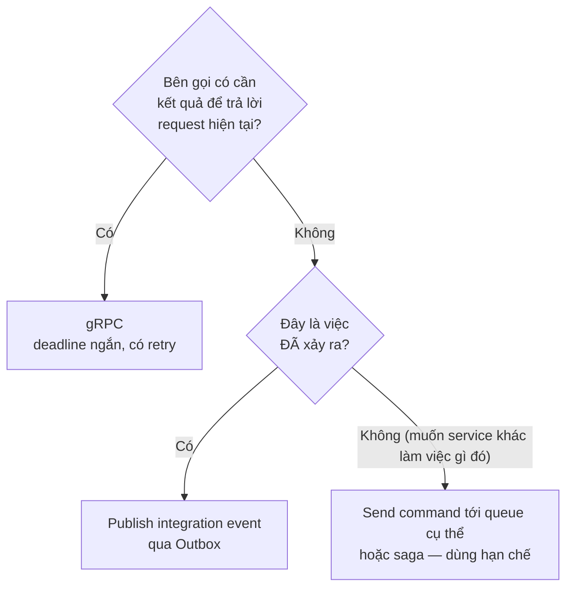
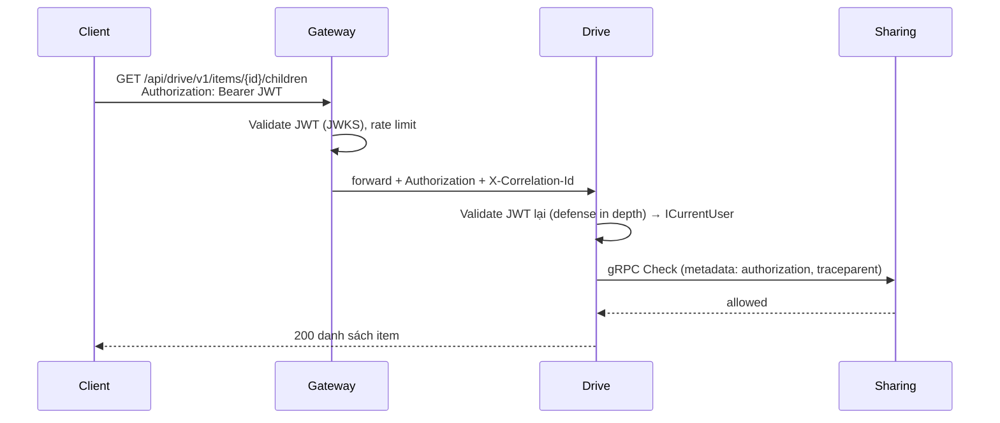

# 04 — Giao tiếp giữa các service: gRPC & Message Queue

## 1. Khi nào dùng gì



| Tình huống | Cơ chế |
|---|---|
| Drive kiểm tra quyền trước khi trả nội dung thư mục | gRPC `Sharing.Check` |
| Drive cần URL upload ngay cho client | gRPC `Storage.CreateUploadSession` |
| Thư mục bị xoá → Search, Sharing, Storage cần biết | Event `ItemsPurged` |
| Tạo thumbnail sau khi upload | Event `FileVersionAdded` → Media Worker |
| Xoá tài khoản (nhiều bước, nhiều service) | Saga (MassTransit state machine) — Phase sau |

## 2. gRPC

### 2.1 Tổ chức hợp đồng

```
BackEnd/src/Contracts/MyCloud.Contracts.Protos/
├── buf.yaml                      # lint: DEFAULT, breaking: FILE
├── mycloud/common/v1/common.proto
├── mycloud/identity/v1/user_service.proto
├── mycloud/storage/v1/storage_service.proto
├── mycloud/sharing/v1/authorization_service.proto
└── mycloud/drive/v1/drive_query_service.proto
```

- Project `.csproj` chỉ chứa file `.proto`. Service phía server dùng `<Protobuf Include="..." GrpcServices="Server" />`, phía client dùng `GrpcServices="Client"` — **link file proto**, không chia sẻ code sinh ra.
- Package: `mycloud.<service>.v1`, `option csharp_namespace = "MyCloud.Contracts.<Service>.V1";`
- Quy tắc tương thích: chỉ **thêm** field/RPC; không đổi số field, không đổi kiểu; bỏ field thì `reserved`. CI chạy `buf lint` + `buf breaking --against main`.
- ID truyền dạng `string` (UUID), thời gian dùng `google.protobuf.Timestamp`, kích thước `int64`.

### 2.2 Bản nháp proto

```protobuf
// mycloud/storage/v1/storage_service.proto
syntax = "proto3";
package mycloud.storage.v1;
option csharp_namespace = "MyCloud.Contracts.Storage.V1";
import "google/protobuf/timestamp.proto";

service StorageService {
  rpc CreateUploadSession(CreateUploadSessionRequest) returns (CreateUploadSessionResponse);
  rpc SignUploadParts(SignUploadPartsRequest) returns (SignUploadPartsResponse);
  rpc CompleteUpload(CompleteUploadRequest) returns (CompleteUploadResponse);
  rpc AbortUpload(AbortUploadRequest) returns (AbortUploadResponse);
  rpc GetDownloadUrl(GetDownloadUrlRequest) returns (GetDownloadUrlResponse);
  rpc CopyBlob(CopyBlobRequest) returns (CopyBlobResponse);
  rpc GetQuota(GetQuotaRequest) returns (Quota);
}

message CreateUploadSessionRequest {
  string user_id = 1;
  int64 size_bytes = 2;
  string mime_type = 3;
  string idempotency_key = 4;          // client retry an toàn
}
message PresignedPart { int32 part_number = 1; string url = 2; }
message CreateUploadSessionResponse {
  string session_id = 1;
  string blob_id = 2;
  int64 part_size = 3;
  int32 part_count = 4;
  repeated PresignedPart parts = 5;     // tối đa 50 part đầu
  google.protobuf.Timestamp expires_at = 6;
}
message SignUploadPartsRequest { string session_id = 1; string user_id = 2; repeated int32 part_numbers = 3; }
message SignUploadPartsResponse { repeated PresignedPart parts = 1; }
message CompletedPart { int32 part_number = 1; string etag = 2; }
message CompleteUploadRequest { string session_id = 1; string user_id = 2; repeated CompletedPart parts = 3; }
message CompleteUploadResponse { string blob_id = 1; int64 size_bytes = 2; string etag = 3; }
message AbortUploadRequest { string session_id = 1; string user_id = 2; }
message AbortUploadResponse {}
message GetDownloadUrlRequest {
  string blob_id = 1;
  string file_name = 2;                 // cho Content-Disposition
  string mime_type = 3;
  bool inline = 4;                       // xem trước thay vì tải về
  int32 ttl_seconds = 5;                 // mặc định 300
}
message GetDownloadUrlResponse { string url = 1; google.protobuf.Timestamp expires_at = 2; }
message CopyBlobRequest { string user_id = 1; string source_blob_id = 2; }  // Phase 3: chỉ chủ sở hữu blob
message CopyBlobResponse { string blob_id = 1; int64 size_bytes = 2; }
message GetQuotaRequest { string user_id = 1; }
message Quota { int64 limit_bytes = 1; int64 used_bytes = 2; int64 reserved_bytes = 3; }
```

```protobuf
// mycloud/sharing/v1/authorization_service.proto
syntax = "proto3";
package mycloud.sharing.v1;
option csharp_namespace = "MyCloud.Contracts.Sharing.V1";

service AuthorizationService {
  rpc Check(CheckRequest) returns (CheckResponse);
  rpc BatchCheck(BatchCheckRequest) returns (BatchCheckResponse);
  rpc GetEffectiveRole(GetEffectiveRoleRequest) returns (GetEffectiveRoleResponse);
}

enum Permission {
  PERMISSION_UNSPECIFIED = 0;
  PERMISSION_VIEW = 1;
  PERMISSION_COMMENT = 2;
  PERMISSION_EDIT = 3;
  PERMISSION_SHARE = 4;
  PERMISSION_DELETE = 5;
}
message Subject {
  oneof kind {
    string user_id = 1;
    string link_token = 2;               // truy cập qua link chia sẻ
  }
}
message CheckRequest {
  Subject subject = 1;
  string item_id = 2;
  Permission permission = 3;
  repeated string ancestor_ids = 4;      // từ gốc → cha trực tiếp; dùng làm contextual tuples
}
message CheckResponse { bool allowed = 1; }
message BatchCheckRequest { Subject subject = 1; Permission permission = 2; repeated CheckItem items = 3; }
message CheckItem { string item_id = 1; repeated string ancestor_ids = 2; }
message BatchCheckResponse { map<string, bool> results = 1; }
message GetEffectiveRoleRequest { Subject subject = 1; string item_id = 2; repeated string ancestor_ids = 3; }
message GetEffectiveRoleResponse { string role = 1; }   // owner|editor|commenter|viewer|none
```

```protobuf
// mycloud/identity/v1/user_service.proto
syntax = "proto3";
package mycloud.identity.v1;
option csharp_namespace = "MyCloud.Contracts.Identity.V1";

service UserService {
  rpc GetUser(GetUserRequest) returns (User);
  rpc BatchGetUsers(BatchGetUsersRequest) returns (BatchGetUsersResponse);
  rpc FindUserByEmail(FindUserByEmailRequest) returns (User);   // NOT_FOUND nếu không có
}
message User { string id = 1; string email = 2; string display_name = 3; string avatar_url = 4; }
message GetUserRequest { string id = 1; }
message BatchGetUsersRequest { repeated string ids = 1; }
message BatchGetUsersResponse { repeated User users = 1; }
message FindUserByEmailRequest { string email = 1; }
```

### 2.3 Cấu hình client/server chuẩn (`MyCloud.BuildingBlocks.Grpc`)

| Vấn đề | Cách làm |
|---|---|
| Đăng ký client | `services.AddGrpcClient<StorageService.StorageServiceClient>(o => o.Address = new("https://storage"))` — địa chỉ phân giải qua service discovery (Aspire/K8s) |
| Deadline | Interceptor đặt deadline mặc định **2 s** nếu caller không đặt; propagate `CancellationToken` từ HTTP request |
| Retry | gRPC service config: retry 3 lần với `UNAVAILABLE`, backoff 100 ms → 1 s. **Không** retry `CompleteUpload`/lệnh ghi trừ khi có `idempotency_key` |
| Xác thực | Interceptor client chuyển tiếp header `authorization` của request gốc (token của user). Server gRPC validate JWT như REST. Với job nền (không có user), service xin token **client-credentials** từ Identity (scope `internal`) |
| Mapping lỗi | Server: interceptor chuyển `DomainException` → `RpcException` (`NOT_FOUND`, `PERMISSION_DENIED`, `FAILED_PRECONDITION`, `RESOURCE_EXHAUSTED` cho quota). Client: chuyển ngược thành `Result.Failure(Error)` |
| Quan sát | OpenTelemetry instrumentation cho gRPC client/server; log method, status, thời gian |
| Health | `Grpc.HealthCheck` (`grpc.health.v1`) |
| Kestrel | Endpoint gRPC riêng `Protocols = Http2` (h2c nội bộ); production bật mTLS qua service mesh hoặc cert nội bộ |

## 3. Integration event (RabbitMQ + MassTransit)

### 3.1 Hợp đồng event (`MyCloud.Contracts.Events`)

- Project **không tham chiếu thư viện nào** (không MassTransit, không EF). Chỉ `record`.
- Mọi event kế thừa:

```csharp
public abstract record IntegrationEvent
{
    public Guid EventId { get; init; } = Guid.CreateVersion7();
    public DateTimeOffset OccurredAt { get; init; } = DateTimeOffset.UtcNow;
    public int SchemaVersion { get; init; } = 1;
}
```

- Đặt tên: `<Danh từ><Động từ quá khứ>` — `ItemMoved`, không phải `MoveItem`.
- Thay đổi không tương thích ⇒ tạo event mới `ItemMovedV2`, publish song song một thời gian.
- Không đưa dữ liệu nhạy cảm (mật khẩu, token, nội dung file) vào event.

### 3.2 Danh mục event

| Event | Publisher | Payload chính | Consumers |
|---|---|---|---|
| `UserRegistered` | Identity | UserId, Email, DisplayName | Drive (tạo root), Storage (tạo quota), Notification (lưu liên hệ, email chào mừng) |
| `UserProfileChanged` | Identity | UserId, DisplayName, AvatarUrl | Notification, Search |
| `ItemCreated` | Drive | ItemId, OwnerId, ParentId, AncestorIds, Kind, Name, MimeType, SizeBytes, Revision, CreatedBy | Sharing (tuple parent/owner), Search |
| `ItemRenamed` | Drive | ItemId, NewName, Revision, By | Search |
| `ItemMoved` | Drive | ItemId, OldParentId, NewParentId, NewAncestorIds, Revision, By | Sharing, Search |
| `ItemTrashed` | Drive | ItemId (gốc của nhóm), OwnerId, By, Revision — con cháu suy ra qua `ancestorIds` | Search |
| `ItemRestored` | Drive | ItemId, OwnerId, ParentId, AncestorIds, Name (có thể đã đổi để không trùng), Revision, By | Search |
| `ItemsPurged` | Drive | ItemIds, BlobIds (mọi version), OwnerId — tối đa 500 item / event | Storage (xoá blob, trả quota), Sharing (xoá tuple + quyền), Search |
| `FileVersionsDeleted` | Drive | ItemId, OwnerId, VersionIds, BlobIds, Revision | Storage (xoá blob, trả quota) |
| `FileVersionAdded` | Drive | ItemId, VersionId, VersionNo, BlobId, SizeBytes, MimeType, By | Storage (claim blob), Media (thumbnail), Search |
| `ItemAccessed` | Drive | ItemId, OwnerId, UserId, Action (open/download) — gộp 5 phút | Search (Gần đây) |
| `ItemShared` | Sharing | PermissionId, ItemId, OwnerId, ItemName, ItemKind, GranteeId, Role, SharedBy, Notify, Message, SharedByName, GranteeEmail | Search (access_grants), Notification |
| `ShareRoleChanged` | Sharing | PermissionId, ItemId, GranteeId, Role, ChangedBy | Search |
| `ShareRevoked` | Sharing | PermissionId, ItemId, GranteeId, RevokedBy | Search |
| `QuotaThresholdReached` | Storage | UserId, Percent (80/90/100), UsedBytes, LimitBytes | Notification |
| `ThumbnailGenerated` | Media | ItemId, VersionId, Sizes | Drive |
| `MalwareDetected` | Media | ItemId, VersionId, Signature | Drive, Notification |

> Event có thể chứa nhiều ID (`AffectedItemIds`) — với cây rất lớn, Drive chia thành nhiều event mỗi event ≤ 1.000 ID.

### 3.3 Publish an toàn: MassTransit Transactional Outbox

Thay `OutboxMessages` + `ProcessOutboxMessagesJob` (Quartz) tự viết bằng **outbox có sẵn của MassTransit**:

```csharp
services.AddMassTransit(x =>
{
    x.AddEntityFrameworkOutbox<DriveDbContext>(o =>
    {
        o.UsePostgres();
        o.UseBusOutbox();                    // IPublishEndpoint trong handler sẽ ghi vào outbox
        o.QueryDelay = TimeSpan.FromMilliseconds(100);
        o.DuplicateDetectionWindow = TimeSpan.FromMinutes(30);
    });
    x.AddConfigureEndpointsCallback((ctx, name, cfg) =>
        cfg.UseEntityFrameworkOutbox<DriveDbContext>(ctx));   // inbox cho consumer → idempotent
    x.SetKebabCaseEndpointNameFormatter();
    x.UsingRabbitMq((ctx, cfg) => { /* host, retry, redelivery */ cfg.ConfigureEndpoints(ctx); });
});
```

Luồng: handler đổi aggregate → aggregate raise domain event (nội bộ) → `DomainEventsToIntegrationEvents` (sau `SaveChanges`, trong cùng transaction) gọi `IPublishEndpoint.Publish(...)` → MassTransit ghi vào bảng outbox **cùng transaction** với dữ liệu → delivery service đẩy sang RabbitMQ.

Phân biệt rõ:
- **Domain event** (nội bộ service, trong `Drive.Domain`): `ItemMovedDomainEvent` — có thể chứa object domain.
- **Integration event** (giữa service, trong `Contracts.Events`): `ItemMoved` — chỉ dữ liệu nguyên thuỷ.

Search (MongoDB) dùng `AddMongoDbOutbox` tương tự, hoặc collection `processed_events` + transaction.

### 3.4 Topology & độ tin cậy

| Thiết lập | Giá trị |
|---|---|
| Exchange | Mỗi loại event 1 exchange fanout (mặc định MassTransit), tên kebab-case `mycloud.contracts.events:item-moved` |
| Queue | Mỗi consumer endpoint 1 queue, tên `<service>-<consumer>` ví dụ `search-item-moved` |
| Retry (in-memory) | `UseMessageRetry(r => r.Exponential(5, 200ms, 10s, 500ms))`, bỏ qua `ValidationException` |
| Redelivery (trễ) | `UseDelayedRedelivery(r => r.Intervals(1m, 5m, 30m))` — cần plugin delayed-message của RabbitMQ |
| Lỗi cuối cùng | Vào queue `_error`; dashboard + alert; công cụ requeue thủ công |
| Concurrency | `PrefetchCount = 32`, `ConcurrentMessageLimit` theo consumer; Media worker = 2–4 |
| Thứ tự | Không đảm bảo ⇒ consumer dùng `Revision` để bỏ qua event cũ |
| Serializer | System.Text.Json mặc định của MassTransit, **không** `TypeNameHandling` |
| Correlation | Header `CorrelationId` = `X-Correlation-Id` của HTTP request gốc; OTel trace context tự propagate |

### 3.5 Consumer idempotent — mẫu

```csharp
public sealed class ItemMovedConsumer(IMongoCollection<SearchItem> items) : IConsumer<ItemMoved>
{
    public async Task Consume(ConsumeContext<ItemMoved> ctx)
    {
        var e = ctx.Message;
        // Chỉ cập nhật nếu event mới hơn bản đang lưu → idempotent + chịu được sai thứ tự
        await items.UpdateOneAsync(
            x => x.Id == e.ItemId && x.Revision < e.Revision,
            Builders<SearchItem>.Update
                .Set(x => x.ParentId, e.NewParentId)
                .Set(x => x.AncestorIds, e.NewAncestorIds)
                .Set(x => x.Revision, e.Revision),
            cancellationToken: ctx.CancellationToken);
        // Con cháu: cập nhật ancestorIds theo lô bằng $pull/$push trên mảng ancestorIds
    }
}
```

## 4. Lan truyền ngữ cảnh người dùng



- `ICurrentUser` (BuildingBlocks) đọc `sub` từ `ClaimsPrincipal` — dùng chung cho REST, gRPC.
- Consumer MassTransit **không** có user; mọi thông tin cần thiết (ai làm) nằm trong payload event (`By`).
