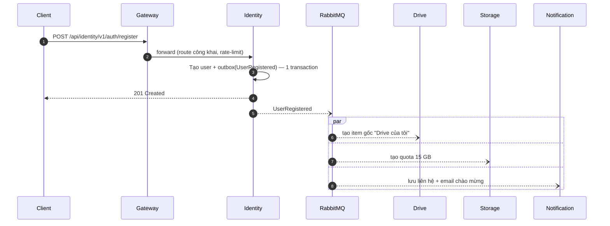
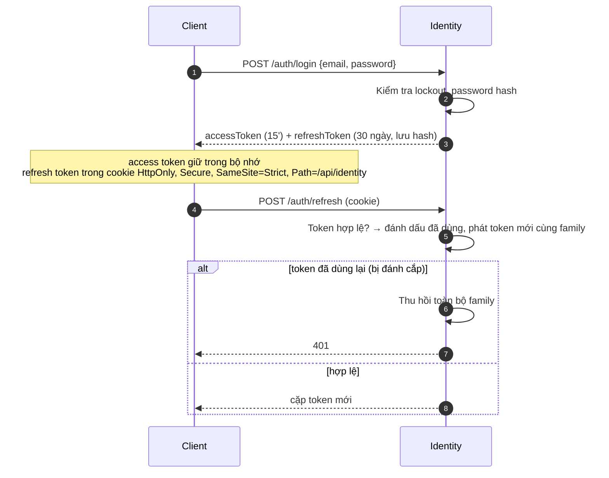
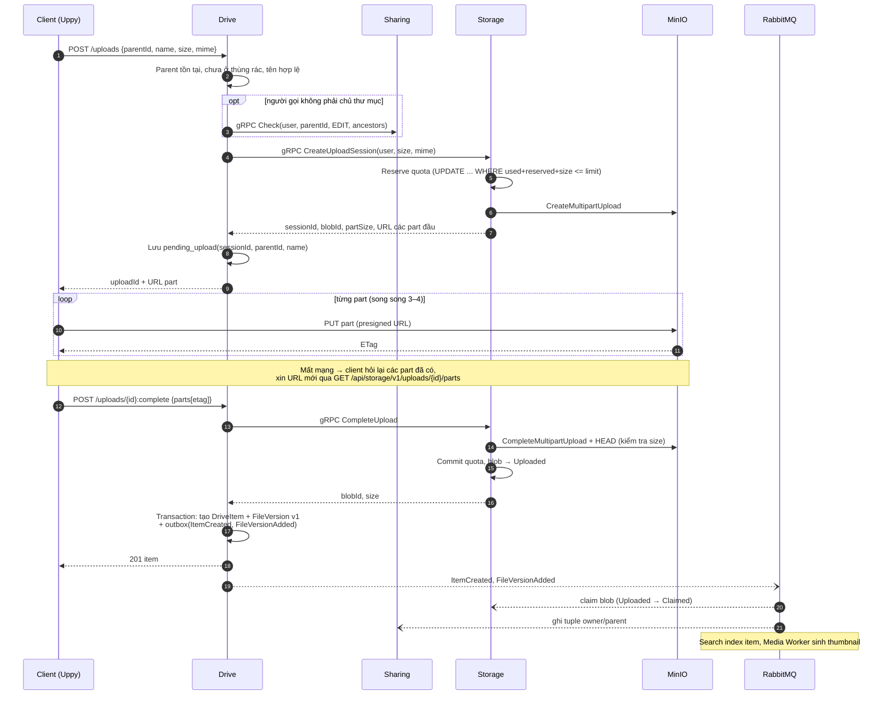
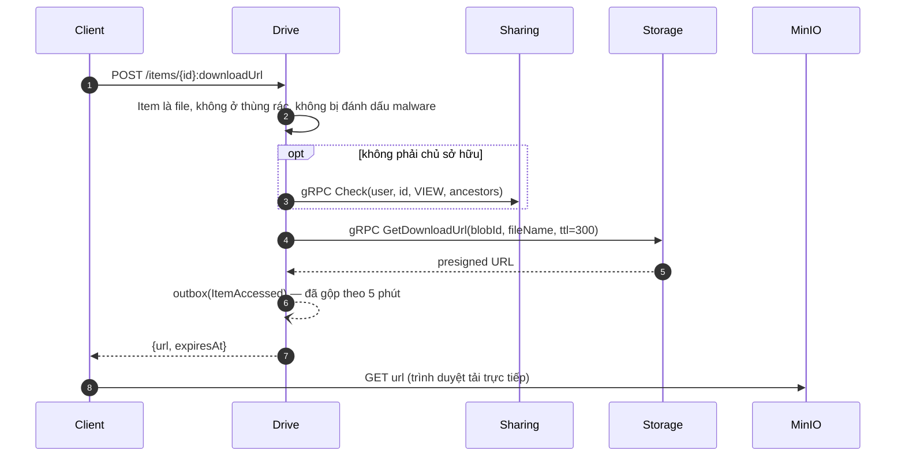
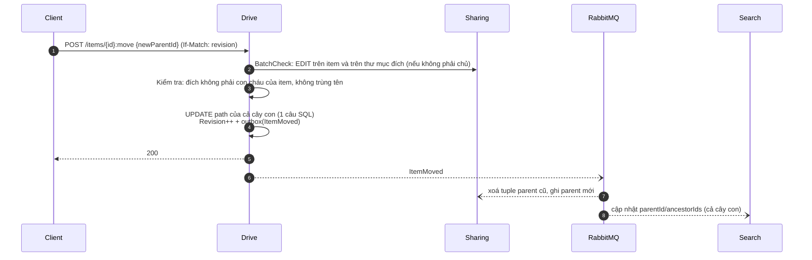
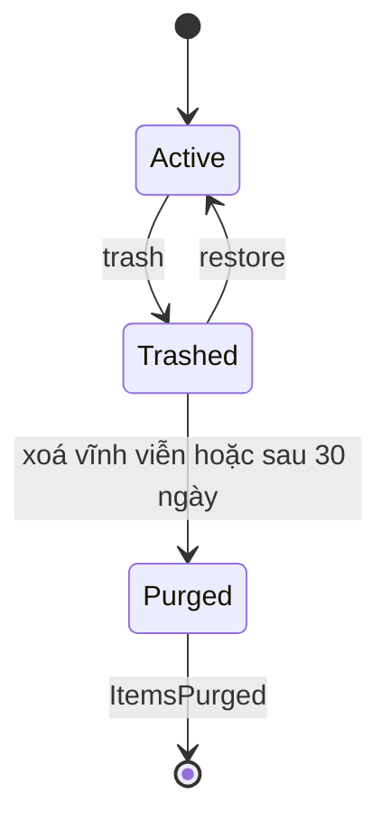
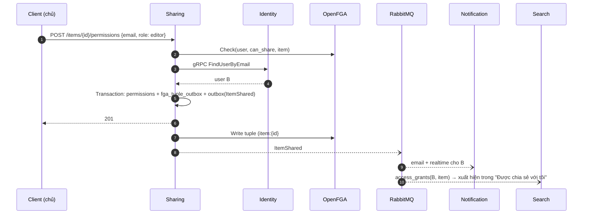
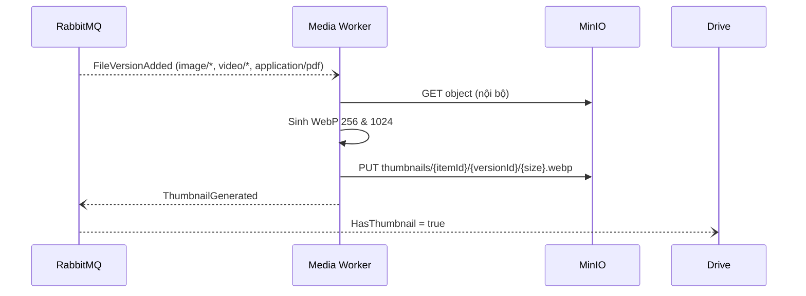

# 05 — Các luồng nghiệp vụ chính

## 1. Đăng ký & khởi tạo tài khoản

Client đăng nhập ngay sau đó có thể gặp trường hợp root chưa kịp tạo (vài trăm ms). `GET /items/root` của Drive xử lý **tạo-nếu-chưa-có** (idempotent, cùng logic với consumer) ⇒ không bao giờ lỗi.

## 2. Đăng nhập & làm mới token

## 3. Upload file (multipart, resume được)

**Xử lý lỗi**

| Sự cố | Kết quả |
|---|---|
| Hết quota ở bước reserve | `CreateUploadSession` trả `RESOURCE_EXHAUSTED` → Drive trả `409` problem `STORAGE.QUOTA_EXCEEDED` |
| Client bỏ dở | Session hết hạn (24 h) → Storage abort multipart, trả quota |
| Storage complete OK nhưng Drive lỗi khi ghi DB | Blob ở trạng thái `Uploaded` không ai claim → GC sau 24 h xoá + trả quota. Client retry `:complete` → Drive gọi lại `CompleteUpload` (idempotent theo sessionId) |
| Size thực tế ≠ size khai báo | Storage từ chối, xoá object, trả quota |
| Trùng tên trong thư mục | Drive tự đổi tên `name (1).ext` (hoặc tạo version mới nếu `targetItemId` được gửi) |

## 4. Tải file / xem trước

## 5. Di chuyển thư mục

## 6. Thùng rác → xoá vĩnh viễn

| Chuyển trạng thái | Chi tiết |
|---|---|
| `:trash` | Đánh dấu item và toàn bộ con cháu (`trash_root_id = item`) |
| `:restore` | Khôi phục cả nhóm có cùng `trash_root_id`; nếu thư mục cha đã bị xoá → khôi phục về root |
| Purge | `DELETE /items/{id}` hoặc job tự động sau 30 ngày |
| `ItemsPurged` | Storage xoá blob & trả quota, Sharing xoá quyền/tuple, Search xoá index |

- File trong thùng rác **vẫn tính quota** (giống Google Drive).
- Purge cây lớn: Drive xoá theo lô 500 item, mỗi lô 1 event `ItemsPurged`.

## 7. Chia sẻ

Chia sẻ qua link: `POST /items/{id}/links` → token ngẫu nhiên (chỉ trả 1 lần, lưu hash), tuple `item:{id}#viewer@link:{linkId}`. Người truy cập mở `https://app/s/{token}` → `GET /api/sharing/v1/links/{token}` (anonymous) → client gọi Drive kèm header `X-Share-Token`; Drive kiểm tra bằng `Check(subject = link_token)`.

## 8. Tạo thumbnail

