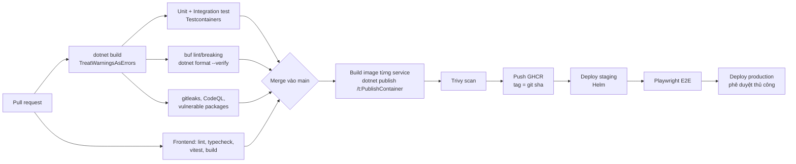

# 06 — Hạ tầng, bảo mật, quan sát, kiểm thử

## 1. Môi trường phát triển local

### Cách 1 (khuyến nghị): .NET Aspire

`MyCloud.AppHost` khai báo toàn bộ hệ thống; `dotnet run --project src/Aspire/MyCloud.AppHost` là chạy được tất cả, kèm dashboard log/trace/metrics.

```csharp
var builder = DistributedApplication.CreateBuilder(args);

var postgres = builder.AddPostgres("postgres").WithDataVolume().WithPgAdmin();
var identityDb = postgres.AddDatabase("identity");
var driveDb    = postgres.AddDatabase("drive");
var storageDb  = postgres.AddDatabase("storage");
var sharingDb  = postgres.AddDatabase("sharing");
var notifyDb   = postgres.AddDatabase("notification");

var mongo    = builder.AddMongoDB("mongo").WithDataVolume().AddDatabase("search");
var rabbit   = builder.AddRabbitMQ("rabbitmq").WithManagementPlugin().WithDataVolume();
var redis    = builder.AddRedis("redis");
var minio    = builder.AddContainer("minio", "minio/minio")
                      .WithArgs("server", "/data", "--console-address", ":9001")
                      .WithHttpEndpoint(9000, 9000, "api").WithHttpEndpoint(9001, 9001, "console");
var openfga  = builder.AddContainer("openfga", "openfga/openfga").WithArgs("run")
                      .WithHttpEndpoint(8080, 8080, "http");
var mailpit  = builder.AddContainer("mailpit", "axllent/mailpit")
                      .WithHttpEndpoint(8025, 8025, "ui").WithEndpoint(1025, 1025, name: "smtp");

var identity = builder.AddProject<Projects.Identity_Api>("identity").WithReference(identityDb).WithReference(rabbit);
var storage  = builder.AddProject<Projects.Storage_Api>("storage").WithReference(storageDb).WithReference(rabbit);
var sharing  = builder.AddProject<Projects.Sharing_Api>("sharing").WithReference(sharingDb).WithReference(rabbit).WithReference(identity);
var drive    = builder.AddProject<Projects.Drive_Api>("drive").WithReference(driveDb).WithReference(rabbit)
                      .WithReference(storage).WithReference(sharing);
var search   = builder.AddProject<Projects.Search_Api>("search").WithReference(mongo).WithReference(rabbit).WithReference(sharing);
var notify   = builder.AddProject<Projects.Notification_Api>("notification").WithReference(notifyDb).WithReference(rabbit).WithReference(redis);
builder.AddProject<Projects.Media_Worker>("media").WithReference(rabbit);

var gateway = builder.AddProject<Projects.MyCloud_Gateway>("gateway").WithReference(redis)
       .WithReference(identity).WithReference(drive).WithReference(storage)
       .WithReference(sharing).WithReference(search).WithReference(notify)
       .WithExternalHttpEndpoints();

builder.AddViteApp("web", "../../FrontEnd/web").WithReference(gateway);
builder.Build().Run();
```

> Đoạn trên là phác thảo — tên API cụ thể (`AddViteApp`, integration MinIO/OpenFGA) phụ thuộc phiên bản Aspire và các gói Community Toolkit tại thời điểm triển khai. Image container phải ghim tag cụ thể, không dùng `latest`.

### Cách 2: docker compose

`deploy/docker-compose.yml` cho người không dùng Aspire / cho CI E2E: postgres (1 instance, nhiều database), mongo (replica set 1 node), rabbitmq (management + delayed-message plugin), redis, minio (+ job tạo bucket), openfga (+ migrate), mailpit, và image của từng service.

### Yêu cầu máy dev
.NET 10 SDK, Node.js 22 LTS, Docker Desktop. (Máy hiện tại mới có SDK 8.0.404 → cần cài .NET 10 SDK.)

## 2. Cấu hình & bí mật

| Loại | Dev | Production |
|---|---|---|
| Connection string, endpoint | Aspire tự inject (`ConnectionStrings__drive`...) | Biến môi trường / ConfigMap |
| Bí mật (DB password, MinIO key, SMTP) | `dotnet user-secrets` | Kubernetes Secret (+ External Secrets / Vault) |
| Khoá ký JWT | Sinh tự động khi dev | Key RSA lưu Secret/Key Vault, xoay vòng 90 ngày, JWKS trả cả key cũ |

**Không** commit bất kỳ secret nào. Thêm `gitleaks` vào CI. Key `oEZqUKrr...` đã nằm trong lịch sử git ⇒ coi như lộ, không dùng lại.

## 3. Bảo mật

| Chủ đề | Biện pháp |
|---|---|
| Xác thực | JWT RS256, validate ở Gateway **và** từng service (`ValidateIssuer/Audience/Lifetime`, `ClockSkew` 30 s) |
| Phân quyền | Mọi endpoint item đi qua `IItemAuthorizer` (fast-path chủ sở hữu → Sharing). Test tích hợp bắt buộc: user B không đọc/sửa/xoá được item của A (IDOR) |
| Mật khẩu | ASP.NET Core Identity (PBKDF2), tối thiểu 8 ký tự, lockout 5 lần/15 phút, rate-limit login theo IP + email |
| Refresh token | Lưu hash, rotation, phát hiện reuse, cookie `HttpOnly; Secure; SameSite=Strict` |
| Object storage | Bucket private; presigned URL ngắn hạn (PUT 1 h, GET 5 phút); object key ngẫu nhiên; `Content-Disposition: attachment` với file không an toàn để tránh XSS khi mở trực tiếp (HTML/SVG) |
| Upload | Giới hạn size, kiểm tra size thật sau upload, (tuỳ chọn) quét ClamAV, không tin `Content-Type` từ client cho preview |
| Link chia sẻ | Token 256-bit, lưu hash, có hạn, có thể đặt mật khẩu, thu hồi được |
| Messaging | Không dùng `TypeNameHandling`; RabbitMQ user riêng từng service, vhost riêng |
| Transport | TLS ở ingress; nội bộ mTLS (service mesh) ở production |
| Header | HSTS, CSP chặt cho web app, `X-Content-Type-Options: nosniff` |
| Kiểm tra | `dotnet list package --vulnerable`, Dependabot, CodeQL, Trivy scan image, OWASP ZAP baseline với staging |
| Dữ liệu cá nhân | Không log email/token/nội dung; EF `EnableSensitiveDataLogging` chỉ bật ở Development; hỗ trợ xoá tài khoản (Phase sau) |

## 4. Quan sát (Observability)

- **ServiceDefaults** (Aspire) cho mọi service: OpenTelemetry tracing (ASP.NET Core, HttpClient, gRPC, EF Core/Npgsql, MongoDB, MassTransit `AddSource("MassTransit")`), metrics, logging → OTLP.
- Log: Serilog giữ nguyên cấu hình hiện có, thêm sink OTLP; enrich `CorrelationId`, `UserId` (đã hash), `Service`.
- Metrics nghiệp vụ: `drive_uploads_completed_total`, `drive_upload_bytes_total`, `storage_quota_used_bytes`, `outbox_pending_messages`, `consumer_lag_seconds`, `sharing_check_duration`.
- Dev: Aspire Dashboard. Production: Prometheus + Grafana, Tempo/Jaeger (trace), Loki (log), Alertmanager.
- Cảnh báo: tỉ lệ 5xx > 1 %, p95 API > 500 ms, queue `_error` có message, outbox tồn đọng > 1 phút, MinIO dung lượng > 80 %.

## 5. Độ bền vững (Resilience)

- HTTP client: `Microsoft.Extensions.Http.Resilience` (`AddStandardResilienceHandler`) — retry, circuit breaker, timeout.
- gRPC: deadline + retry policy (mục 2.3 tài liệu 04).
- DB: retry transient (Npgsql execution strategy).
- MassTransit: retry + delayed redelivery + DLQ.
- Graceful shutdown, readiness probe chỉ "ready" khi kết nối DB/broker OK.
- Backup: `pg_dump`/WAL archiving hằng ngày, MongoDB backup, MinIO bật versioning + replication (production).

## 6. Chiến lược kiểm thử

| Tầng | Công cụ | Phạm vi |
|---|---|---|
| Unit | xUnit + Shouldly/FluentAssertions | Domain (`DriveItem`: đổi tên, di chuyển, thùng rác, invariant), handler với fake repository |
| Kiến trúc | NetArchTest | Domain không tham chiếu Infrastructure; service không tham chiếu project của service khác; Contracts không tham chiếu framework |
| Integration | `WebApplicationFactory` + **Testcontainers** (Postgres, RabbitMQ, MinIO, Mongo) | API thật + DB thật; luồng upload complete; kiểm tra IDOR |
| Messaging | MassTransit Test Harness | Event được publish đúng, consumer idempotent khi nhận trùng/sai thứ tự |
| Contract gRPC | `buf lint`, `buf breaking` | Không phá tương thích |
| E2E | Playwright (chạy với docker compose) | Đăng ký → upload → chia sẻ → user khác xem được |
| Hiệu năng | k6 | Liệt kê thư mục 10k item, 200 upload đồng thời |

Mục tiêu coverage: Domain ≥ 90 %, Application ≥ 70 %. Mỗi bug sửa phải kèm test tái hiện.

## 7. CI/CD (GitHub Actions)



- Dùng **path filter** để chỉ build/test service có thay đổi.
- Image build bằng .NET SDK container support (không cần Dockerfile), base image `chiseled`.
- Migration DB chạy bằng **job riêng** trước khi rollout (EF bundle), không tự migrate lúc service khởi động ở production.

## 8. Triển khai production (định hướng)

- Kubernetes (k3s/AKS/EKS…), 1 Helm chart chung tham số hoá cho các service.
- Ingress NGINX/Traefik + cert-manager (Let's Encrypt) trước Gateway.
- Stateful: PostgreSQL (CloudNativePG hoặc managed), MongoDB (managed hoặc operator), RabbitMQ (cluster operator), MinIO (distributed) hoặc S3/R2.
- HPA theo CPU/RPS cho Gateway, Drive; KEDA scale Media Worker theo độ dài queue.
- Phase đầu có thể chạy trên **1 VPS bằng docker compose** để demo — kiến trúc không thay đổi.
