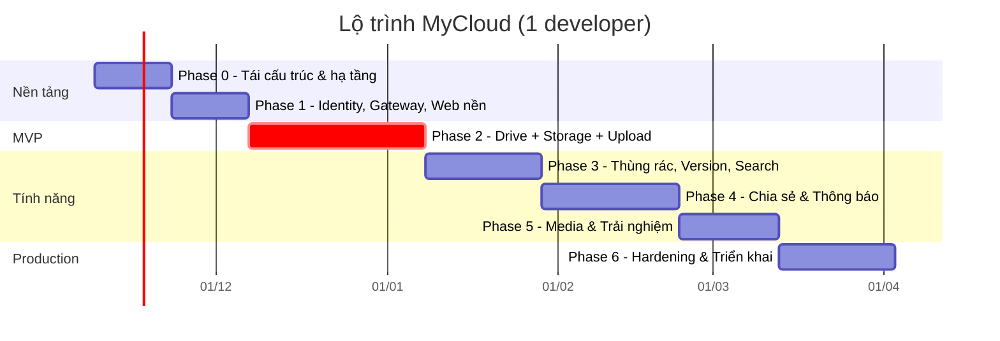

# 07 — Kế hoạch thực hiện

## 1. Nguyên tắc lập kế hoạch

1. **Sửa nền trước, mở rộng sau**: xác thực, quyền sở hữu, lưu trữ file là lõi — làm đúng trước khi thêm tính năng.
2. **Mỗi phase kết thúc bằng một bản chạy được end-to-end** (backend + frontend + test), không làm "hết backend rồi mới làm frontend".
3. **Tái sử dụng code cũ có chọn lọc** (bảng mapping ở mục 4) — không viết lại những gì đang tốt.
4. Làm trên nhánh, merge qua PR có CI xanh.

Ước lượng tính cho **1 developer full-time**: tổng ≈ 20 tuần (≈ 5 tháng), MVP sau ≈ 8–9 tuần. Với 2–3 người, từ Phase 2 có thể chạy song song (Drive / Storage / Frontend) và rút còn ≈ 3 tháng.

## 2. Lộ trình tổng quan

| Mốc | Sau phase | Ý nghĩa |
|---|---|---|
| **M1 — MVP** | 2 | Đăng ký, đăng nhập, cây thư mục, upload file lớn (resume), tải về; dữ liệu cách ly theo user |
| **M2 — Beta** | 4 | Thùng rác, version, tìm kiếm, gần đây, chia sẻ (user + link), thông báo |
| **M3 — Production** | 6 | Thumbnail/preview, quan sát, bảo mật đã rà soát, triển khai K8s/VPS, backup |

---

## Phase 0 — Tái cấu trúc & hạ tầng (≈ 2 tuần)

**Mục tiêu**: repo sạch, chạy toàn bộ hạ tầng bằng 1 lệnh, CI hoạt động.

- [x] Cài .NET 10 SDK; tạo `global.json`; nâng mọi project lên `net10.0`.
- [x] `Directory.Build.props` (Nullable, ImplicitUsings, `TreatWarningsAsErrors`), `Directory.Packages.props` (Central Package Management); ghim MassTransit 8.5.x, MediatR 12.5.x; bỏ AutoMapper, Quartz, Newtonsoft, Swashbuckle, Serilog (log đi qua OpenTelemetry).
- [x] Tạo `MyCloud.slnx` theo cấu trúc ở [02 §8](02-kien-truc-tong-the.md#8-cấu-trúc-thư-mục-mục-tiêu); đổi tên project/namespace, sửa lỗi chính tả (`BuidingBlock` → `BuildingBlocks`...). Command → **Drive** (4 project), Query → **Search** (1 project), Auth → **Identity.Api** (1 project, tách ở Phase 1).
- [x] Tách BuildingBlocks: `Domain`, `Application` (pipeline Performance → Validation → UnitOfWork), `Messaging`, `Grpc` (interceptor map lỗi, deadline), `Web` (ProblemDetails, versioning, OpenAPI + Scalar, Carter).
- [x] `MyCloud.Contracts.Events` (không phụ thuộc gì) và `Contracts/Protos` (thư mục `.proto` + `buf.yaml`, không phải csproj — service link file proto trực tiếp).
- [x] Aspire `AppHost` + `ServiceDefaults` (OTel, health `/health/live|ready`, resilience, service discovery). Postgres, Mongo, RabbitMQ, Redis, MinIO, Mailpit. *(Mongo replica set để Phase 3 khi cần transaction.)*
- [x] `deploy/docker-compose.yml` cho hạ tầng *(image service để Phase 6)*.
- [x] Chuyển EF Core sang **PostgreSQL** (Npgsql, snake_case), mỗi service 1 database, xoá migration SQL Server cũ, tạo migration mới.
- [x] Gỡ toàn bộ secret khỏi `appsettings*.json`; khoá JWT tạm thời do Aspire sinh + lưu user-secrets; gitleaks chạy trong CI. **Khoá cũ đã nằm trong lịch sử git — coi như lộ.**
- [x] Thay outbox tự viết (Quartz) bằng **MassTransit EF Core Outbox** (Drive, Identity); bỏ `TypeNameHandling`, dùng serializer mặc định.
- [x] Test projects: `Drive.Domain.Tests`, `Drive.IntegrationTests` (Testcontainers + MassTransit test harness), `Architecture.Tests` (NetArchTest + kiểm tra không tham chiếu chéo service).
- [x] GitHub Actions `backend-ci.yml`: build + test + `dotnet format --verify-no-changes` + vulnerable packages + `buf lint/breaking` + gitleaks.
- [x] `README.md` gốc và `BackEnd/README.md`: cách chạy, cấu trúc.

Sửa thêm trong Phase 0 (vì code được chuyển sang cấu trúc mới): bug `Register` (S8), lỗi đăng nhập lộ user (S9), `UpdateFile` xoá liên kết nội dung (S6), 500 khi id không tồn tại (S7), xoá thư mục bỏ mặc con (S10 — tạm chặn xoá thư mục không rỗng), audit `CreatedBy = Guid.NewGuid()` (S2, giờ lấy từ `ICurrentUser`), poll outbox 10.000 lần/s (R1), projection không idempotent/sai thứ tự (R3, R5), đường dẫn lưu file hard-code (S5 — tạm lưu ổ đĩa theo cấu hình đến Phase 2), CORS `*`.

**Hoàn thành khi**: `dotnet run --project src/Aspire/MyCloud.AppHost` khởi động mọi container + service khung, dashboard xanh; CI xanh trên PR; `git grep SecretKey` không còn giá trị thật.

---

## Phase 1 — Identity, Gateway, Web nền (≈ 2 tuần)

**Backend**
- [x] Identity: register / login / refresh (rotation + phát hiện reuse) / logout / `users/me` (GET, PATCH) / đổi mật khẩu (thu hồi mọi phiên). Thông báo lỗi đăng nhập không lộ user.
- [x] Rút gọn `AppUser` (bỏ trường HR), thêm `DisplayName`, `AvatarUrl` *(làm từ Phase 0)*.
- [x] JWT **RS256** + `/.well-known/openid-configuration` + `/.well-known/jwks.json`; xoay vòng khoá tự động (ADR-012).
- [x] Publish `UserRegistered`, `UserProfileChanged` qua outbox.
- [x] `BuildingBlocks.Authentication` (mới): JWT bearer lấy khoá từ JWKS qua service discovery, **fallback policy yêu cầu đăng nhập** cho mọi endpoint. `BuildingBlocks.Web` dùng lại; thêm `ICurrentUser.GetRequiredUserId()`.
- [x] Gateway: xác thực theo route (`/auth/*` ẩn danh), rate limit (login/register 5/phút/IP, refresh/logout 30/phút/IP, API 100 req/s/user), `X-Correlation-Id`, xoá header nội bộ (`X-User-Id`, `X-Internal-*`), body tối đa 1 MB.
- [x] Drive + Search: dữ liệu cách ly theo chủ sở hữu (`OwnerId`); item của người khác ⇒ 404. *(Kéo từ Phase 2 lên: bật xác thực mà không lọc theo user sẽ mở lỗ hổng IDOR.)*

**Frontend**
- [x] Tạo `FrontEnd/web`: Vite 6 + React 19 + TypeScript, ESLint, Prettier, Vitest; xoá app CRA cũ `my-drive`.
- [x] Port layout cũ (header, menu điều hướng, nút "Mới") sang TS + MUI; mục chưa làm hiển thị phase sẽ làm.
- [x] Trang đăng nhập / đăng ký / quản lý tài khoản thật; API client tự refresh khi gặp 401 (nhiều request dùng chung một lần refresh); `ProtectedRoute` dựa trên trạng thái thật (khôi phục phiên từ cookie khi tải trang).
- [x] TanStack Query; "Drive của tôi" bản tối thiểu (liệt kê, mở thư mục, tạo thư mục).
- [x] Aspire chạy cả web (`AddViteApp`); Vite proxy `/api` → Gateway nên SPA và API cùng origin. CI riêng `frontend-ci.yml`.

**Test**: integration Identity (14 test: JWKS, cookie, trùng email, sai mật khẩu, lockout, refresh rotation, dùng lại token ⇒ thu hồi family, logout, đổi mật khẩu); Drive (IDOR, 401 khi thiếu / sai chữ ký / hết hạn token); Gateway (401, rate limit 429, correlation id); frontend 22 test (Vitest).

**Lệch so với kế hoạch**
- gRPC `UserService` và `GET /users/lookup`, `/users:batchGet` dời sang **Phase 4**: người gọi duy nhất là Sharing, làm khi có người dùng thật. Nền tảng gRPC (endpoint HTTP/2 riêng) làm ở Phase 2 cùng lời gọi Drive → Storage.
- Identity vẫn là **1 project** (chia thư mục Auth / Users / Tokens / Keys / Data): logic chủ yếu là glue với ASP.NET Core Identity, tách 4 tầng không đem lại gì.
- Node.js trên máy dev là 20.18 (đã hết hỗ trợ 04/2026) nên chọn Vite 6, ESLint 9, React Router 7 thay vì bản mới nhất (cần Node ≥ 20.19 / 22). CI chạy Node 24. **Nên nâng máy dev lên Node 24 LTS** rồi nâng các gói này.

**Hoàn thành khi**: đăng ký + đăng nhập từ web; mọi API không có token → 401; refresh hoạt động sau 15 phút.

---

## Phase 2 — Drive + Storage + Upload/Download → **MVP** (≈ 4–5 tuần)

**Drive service** (thay mô hình Folder/File tạm thời)
- [x] Aggregate `DriveItem` + `FileVersion`, `ItemName` (NFC + không phân biệt hoa thường), materialized path `/{root}/.../{id}/`.
- [x] Schema Postgres + index: unique `(parent_id, name_key)`, `(parent_id, kind, name_key)`, `path text_pattern_ops`, một root mỗi user; `Revision` là concurrency token (lưu đè ⇒ 412).
- [x] Consumer `UserRegistered` → tạo root; `GET /items/root` tạo-nếu-chưa-có (user đăng ký trước Phase 2).
- [x] Tạo thư mục, liệt kê con (thư mục trước, sắp xếp theo tên / sửa đổi / kích thước, phân trang bằng page token), breadcrumb (`/ancestors`), đổi tên (`If-Match`), di chuyển (cập nhật path cả cây con bằng 1 câu UPDATE trong cùng transaction, chặn di chuyển vào con cháu).
- [x] Phân quyền: chỉ chủ sở hữu, qua `IItemAuthorizer` (Phase 4 cắm Sharing vào); item của người khác ⇒ 404.
- [x] Upload: `POST /uploads`, `POST /uploads/{id}/complete` (idempotent), `DELETE /uploads/{id}`; bảng `pending_uploads`; trùng tên ⇒ tự đổi `report (1).pdf`.
- [x] Download: `POST /items/{id}/download-url` → presigned GET 5 phút, `Content-Disposition` giữ tên tiếng Việt (RFC 6266).
- [x] Publish `ItemCreated`, `ItemRenamed`, `ItemMoved`, `FileVersionAdded` (có `Revision`, `AncestorIds`).

**Storage service**
- [x] Client S3 chuẩn (AWSSDK.S3 v4), tạo bucket khi khởi động, bucket private, rule lifecycle abort multipart sau 7 ngày (best-effort).
- [x] Bảng `blobs`, `quotas`; giữ chỗ / ghi nhận / trả quota bằng UPDATE có điều kiện (atomic), cùng transaction với trạng thái blob.
- [x] gRPC `StorageService` (CreateUploadSession, SignUploadParts, CompleteUpload, AbortUpload, GetDownloadUrl, GetQuota) — kiểm tra kích thước thật sau upload (khai nhỏ upload lớn ⇒ xoá, trả quota).
- [x] REST `GET /uploads/{id}/parts` (resume), `POST /uploads/{id}/part-urls`, `GET /quota`.
- [x] Consumer `UserRegistered` (quota), `FileVersionAdded` (claim).
- [x] Job: hết hạn upload session, GC blob không được claim sau 24 h.

**gRPC nền tảng**
- [x] `BuildingBlocks.Grpc`: deadline mặc định, chuyển tiếp JWT của người dùng, không retry tự động ở tầng HTTP, mã lỗi nghiệp vụ đi trong trailer `x-error-code`; endpoint Kestrel HTTP/2 riêng (`grpc`) phân giải qua service discovery `http://_grpc.storage`.

**Frontend**
- [x] Trang "Drive của tôi": dạng danh sách / lưới, breadcrumb, sắp xếp, chọn nhiều (Ctrl/⌘ + click, checkbox).
- [x] Tạo thư mục, đổi tên, di chuyển (hộp thoại duyệt cây), menu chuột phải.
- [x] Upload multipart song song, kéo thả, bảng tiến độ, huỷ / thử lại, tự tiếp tục khi có mạng lại, ký lại URL hết hạn.
- [x] Tải xuống; thanh dung lượng + trang Bộ nhớ.

**Test**
- [x] Domain tests cho `DriveItem`, `ItemName` (27).
- [x] Integration Drive (19): cây thư mục, phân trang, 412 `If-Match`, di chuyển cả cây con, upload idempotent, đổi tên khi trùng, quota, **IDOR** (11 thao tác của user B trên dữ liệu A ⇒ 404).
- [x] Integration Storage với **MinIO thật** (9): upload 2 part qua presigned URL rồi tải về khớp từng byte, vượt quota, sai kích thước, huỷ, resume, chặn user khác, job dọn dẹp + claim.
- [x] Frontend: bộ upload multipart (7 test: song song, thử lại, 403 ⇒ ký lại, mất mạng, huỷ).

**Lệch so với kế hoạch**
- **Upload trình duyệt tự viết thay cho Uppy**: ~200 dòng, khớp thẳng API Drive/Storage, không thêm thư viện; resume trong cùng phiên (mất mạng / lỗi tạm thời). Resume sau khi tải lại trang chưa làm (API `GET /uploads/{id}/parts` đã có sẵn).
- **Presigned URL ký theo origin của trình duyệt** và object storage được proxy cùng origin (`/mycloud-blobs/` qua Vite / nginx) — không cần CORS, chạy được qua localhost, `mycloud.localhost` và IP trong LAN (ADR-013).
- `upload_sessions` gộp vào `blobs` (1 session ↔ 1 blob, cùng vòng đời).
- Đường dẫn dùng `/uploads/{id}/complete`, `/items/{id}/move`, `/items/{id}/download-url` thay cho kiểu `:complete` (route template ASP.NET không hỗ trợ tốt dấu `:` sau tham số).
- Page token hiện mã hoá vị trí (offset) — vẫn là chuỗi mờ với client, đổi sang keyset sau mà không đổi API.
- `CopyBlob` dời sang Phase 3 (cùng chức năng sao chép); xoá / thùng rác ở Phase 3 như kế hoạch.
- Search chuyển sang chiếu `Item*` event, kèm tìm theo tên đơn giản (`GET /search?q=`).
- Dữ liệu Folder/File của Phase 0–1 (chỉ ở dev) không được chuyển đổi — migration xoá bảng cũ.

**Hoàn thành khi (MVP)**: upload file 1 GB, ngắt mạng giữa chừng vẫn resume được; tạo/di chuyển/đổi tên thư mục; tải về đúng tên file; hai user hoàn toàn cách ly dữ liệu; trace một lần upload xem được trọn vẹn trên dashboard.

---

## Phase 3 — Thùng rác, Version, Gắn sao, Search ✅

**Drive**
- [x] Thùng rác theo **nhóm** (`trash_root_id`): xoá thư mục đánh dấu nó + mọi con cháu chưa bị xoá trong cùng transaction (1 câu UPDATE); khôi phục trả đúng cả nhóm, item đã xoá riêng trước đó vẫn ở thùng rác. Cha đang ở thùng rác ⇒ khôi phục về "Drive của tôi"; trùng tên ⇒ tự đổi `tên (1)`.
- [x] Item trong thùng rác: xem / tải / xem version được, mọi thay đổi ⇒ 409 `DRIVE.ITEM_TRASHED`; tên được giải phóng (unique index có điều kiện `trashed_at IS NULL`).
- [x] Xoá vĩnh viễn (`DELETE /items/{id}`), dọn sạch (`DELETE /trash`), job xoá sau 30 ngày (cấu hình); theo lô 500 item sâu nhất trước, mỗi lô một transaction + 1 event `ItemsPurged` (kèm blob của **mọi** version).
- [x] Event `ItemTrashed`, `ItemRestored` (chỉ item gốc của nhóm — consumer suy ra phần còn lại qua `AncestorIds`), `ItemsPurged`.
- [x] Version: upload với `targetItemId` ⇒ version mới; liệt kê; tải một version cụ thể; **khôi phục = version mới** có nội dung cũ (Storage `CopyBlob`), xoá version cũ; giữ tối đa `Drive:MaxVersionsPerFile` (mặc định 100) ⇒ event `FileVersionsDeleted`.
- [x] Sao chép file (`CopyBlob`) và thư mục (cả cây, tối đa 500 item / lần, kiểm tra dung lượng trước).
- [x] Gắn sao (`PUT/DELETE /items/{id}/star`, idempotent), `GET /starred` (ẩn item trong thùng rác); `starred` trong mọi `ItemDto`.
- [x] `ItemAccessed` khi lấy link tải / mở, gộp tối đa 1 event / người / item / 5 phút bằng 1 câu UPSERT có điều kiện.

**Storage**
- [x] gRPC `CopyBlob` (giữ chỗ quota → CopyObject → Uploaded, chờ Drive claim như upload thường).
- [x] Consumer `ItemsPurged`, `FileVersionsDeleted` → xoá object (DeleteObjects theo lô) rồi đổi trạng thái → `Deleted` có điều kiện, trả quota đúng một lần (idempotent, bỏ qua blob của người khác).

**Search service**
- [x] Read model `items` thêm `ancestorIds`, `category`, `nameFolded` (tìm không dấu: "bao cao" thấy "Báo cáo"), `trashed`; collection `recent` (TTL 90 ngày) và `activity` (TTL 180 ngày).
- [x] Áp dụng theo `Revision`; con cháu khi di chuyển / khôi phục được đồng bộ **theo trạng thái hiện tại của thư mục cha** (update pipeline) nên event đến sai thứ tự vẫn hội tụ; event cùng chủ sở hữu xử lý tuần tự (MassTransit partitioner theo `OwnerId`).
- [x] `GET /search?q=&type=&modifiedAfter=&pageToken`, `GET /recent`, `GET /items/{id}/activity` (thư mục gồm cả hoạt động bên trong).

**Frontend**
- [x] Trang Thùng rác (khôi phục, xoá vĩnh viễn, dọn sạch có xác nhận), Có gắn dấu sao, Gần đây; trang chủ hiện tệp gần đây.
- [x] Ô tìm kiếm trên thanh trên cùng + trang kết quả có lọc loại / thời gian sửa.
- [x] Panel chi tiết: thông tin, hoạt động, phiên bản (tải, khôi phục, xoá, tải lên phiên bản mới).
- [x] Menu thao tác dùng chung: tạo bản sao, gắn sao, chuyển vào thùng rác (có "Huỷ"), phím Delete.

**Test**
- [x] Domain (+10): thùng rác, khôi phục, version, giới hạn version.
- [x] Integration Drive (+14): nhóm thùng rác, sửa item đã xoá ⇒ 409, khôi phục về gốc + đổi tên, xoá vĩnh viễn phát đủ blob, dọn sạch, job 30 ngày, version (upload / khôi phục / xoá / giới hạn), gắn sao, sao chép cây, quá giới hạn / quota, gộp `ItemAccessed`, **IDOR** cho 11 thao tác mới.
- [x] Integration Storage (+4, MinIO thật): `CopyBlob` (byte giống hệt, tính quota, chặn người khác, quá quota không rò giữ chỗ), `ItemsPurged` (xoá object, trả quota đúng một lần), `FileVersionsDeleted`.

**Lệch so với kế hoạch**
- **Sao chép thư mục chạy trong request** (tối đa 500 item) thay vì job nền: job nền không có JWT của người dùng để gọi Storage; làm khi có định danh service (Phase 4/5).
- **Không dùng inbox/transaction Mongo** (nên chưa cần replica set): consumer của Search idempotent theo cách dựng (điều kiện revision, `_id` = id event, upsert tiến về phía trước).
- `ItemTrashed` / `ItemRestored` không mang danh sách id con (`AffectedItemIds`) — Search ẩn cây con qua `ancestorIds`.
- Khôi phục version tạo version mới (sao chép blob) thay vì trỏ lại version cũ: lịch sử chỉ tiến về phía trước, không blob nào bị hai version dùng chung.
- `GET /search` chưa có lọc chủ sở hữu (`owner=others`) — chỉ có ý nghĩa khi có chia sẻ (Phase 4). Document Search tạo trước Phase 3 không có `ancestorIds` (dữ liệu dev).

**Hoàn thành khi**: xoá thư mục 1.000 file → khôi phục đầy đủ; xoá vĩnh viễn → object trong MinIO biến mất và quota giảm; tìm thấy file vừa upload trong < 2 s.

---

## Phase 4 — Chia sẻ & Thông báo ✅

**Định danh service** ([ADR-014](08-adr.md#adr-014))
- [x] Identity: `POST /connect/token` (client credentials, nội bộ), token cùng JWKS, scope `mycloud.internal`; policy `service`.
- [x] `BuildingBlocks`: `AddServiceIdentity()` (lấy + cache token), `AddGrpcServiceClient<T>()`; AppHost sinh secret của Drive.
- [x] Identity gRPC `UserService` (FindUserByEmail, BatchGetUsers — chỉ service) + REST `GET /users?ids=` cho tên hiển thị.

**Sharing service** (PostgreSQL thay OpenFGA — ADR-014)
- [x] `permissions`, `share_links` (hash token, mật khẩu PBKDF2), outbox/inbox; consumer `ItemsPurged` xoá quyền + link.
- [x] gRPC `SharingService`: CheckAccess / BatchCheckAccess (owner > quyền trực tiếp / kế thừa từ tổ tiên > link), List /
      Grant / Revoke, Create / List / Disable / ResolveLink. Publish `ItemShared`, `ShareRoleChanged`, `ShareRevoked`.

**Drive**
- [x] `IItemAuthorizer` = fast-path chủ sở hữu → Sharing (một lời gọi cho cả lô); vai trò của người gọi trong mọi `ItemDto`
      (`role`, `ownerId`, `modifiedBy`); không có quyền ⇒ 404, thiếu quyền ⇒ 403 `DRIVE.ACCESS_DENIED`.
- [x] Quyền: xem (viewer+), sửa / chia sẻ (editor+), thùng rác / khôi phục / xoá vĩnh viễn (chỉ chủ sở hữu). Item trong
      thùng rác chỉ chủ sở hữu thấy. Breadcrumb của người được chia sẻ bắt đầu từ thư mục được chia sẻ.
- [x] REST chia sẻ: `GET /items/{id}/sharing`, `POST/PATCH/DELETE /items/{id}/permissions`, `POST/DELETE /items/{id}/links`.
- [x] Link công khai: `GET /public/links/{token}`, `/items/{id}`, `/children`, `/ancestors`, `POST /download-url` (ẩn danh,
      mật khẩu trong header `X-Link-Password`, Gateway rate limit 120/phút/IP).
- [x] Người chỉnh sửa upload vào thư mục được chia sẻ: chủ sở hữu trả dung lượng; sao chép file được chia sẻ vào Drive mình.

**Storage**: tin token service; `uploader_id` (chỉ người upload ký part); `CopyBlob` từ chủ sở hữu khác; publish
`QuotaThresholdReached` (80 / 90 / 100 %).

**Search**: `access_grants` (từ event của Sharing), `GET /shared-with-me`, tìm kiếm / Gần đây / hoạt động gồm cả item được
chia sẻ (và ẩn khi chủ sở hữu xoá), lọc `owner=me|others`.

**Notification service**
- [x] Liên hệ từ `UserRegistered` / `UserProfileChanged`; email chào mừng và "đã chia sẻ với bạn" qua SMTP (Mailpit), có
      lời nhắn; thông báo trong app cho `ItemShared`, `QuotaThresholdReached`.
- [x] Email và đẩy realtime là bản tin nội bộ đi qua outbox (chỉ xảy ra khi thông báo đã lưu, retry riêng).
- [x] REST `GET /notifications`, `POST /notifications/{id}/read`, `POST /notifications/read-all`; SignalR hub qua Gateway
      (token trong query `access_token` chỉ cho đường dẫn `/hubs/`), Redis backplane.

**Frontend**: hộp thoại chia sẻ (thêm theo email, vai trò, lời nhắn, đổi / thu hồi, quyền kế thừa, link + mật khẩu),
"Được chia sẻ với tôi", trang mở link `/s/:token` (không cần đăng nhập), chuông thông báo realtime, ẩn thao tác theo vai trò.

**Test**
- [x] **Ma trận quyền** chạy qua Drive + Sharing thật (gRPC trong tiến trình): owner / editor / commenter / viewer / không
      quyền × trực tiếp / kế thừa × xem / sửa / chia sẻ / xoá; link (duyệt, tải, ngoài phạm vi, tắt link, mật khẩu).
- [x] Drive (+17): chia sẻ theo email, thu hồi tức thì, đổi vai trò, upload của người chỉnh sửa, không di chuyển sang Drive
      khác, breadcrumb, item trong thùng rác biến mất với người được chia sẻ, `ItemsPurged` xoá quyền ở Sharing.
- [x] Identity (+3), Storage (+3, token service), Notification (5, mới), frontend menu theo vai trò (+3).

**Lệch so với kế hoạch**
- **Không dùng OpenFGA** — quyền trong PostgreSQL của Sharing, kế thừa tính từ tổ tiên do Drive gửi (ADR-014).
- REST chia sẻ nằm ở **Drive** (`/api/drive/v1/items/{id}/permissions…`) thay vì Sharing; Sharing chỉ có gRPC nội bộ.
- Link chỉ cấp quyền **xem** (viewer / commenter): sửa cần biết ai sửa ⇒ chỉ cấp cho người dùng cụ thể.
- Search không gọi `BatchCheck` để xác nhận trang kết quả: `access_grants` cập nhật theo event (trễ vài giây); mở item vẫn
  luôn được Drive kiểm tra quyền tức thì.
- Chưa có "người được chia sẻ tự rời khỏi mục" và chia sẻ cho người chưa có tài khoản (lời mời qua email).

**Hoàn thành khi**: A chia sẻ thư mục cho B quyền xem → B nhận thông báo realtime, thấy thư mục và mọi file con, không sửa được; A thu hồi → B mất quyền ngay lập tức.

---

## Phase 5 — Media & Trải nghiệm ✅

**Media Worker** ([ADR-015](08-adr.md#adr-015))
- [x] `FileVersionAdded` → thumbnail WebP 256 / 1024 px: ảnh (SkiaSharp, lấy mẫu khi giải mã, xoay theo EXIF, chặn ảnh
      > 120 MP), trang đầu PDF (PDFium), khung hình video (ffmpeg — tuỳ chọn, `Media:FfmpegPath`).
- [x] Đọc / ghi qua gRPC của Storage bằng định danh service `media` (không giữ khoá object storage);
      `ThumbnailGenerated` → Drive đánh dấu version hiện tại có thumbnail.
- [x] Giới hạn: kích thước file nguồn, số file xử lý đồng thời, timeout ffmpeg; nội dung hỏng ⇒ bỏ qua, không retry.

**Storage**
- [x] Thumbnail theo blob (`t/{blobId}/{size}.webp`), xoá cùng blob, URL có cache; gRPC `PutThumbnail`, `GetThumbnailUrls`
      (chỉ service).
- [x] Tệp zip: gRPC `CreateArchive` → hàng đợi `archives` → worker stream vào S3 multipart; `ArchiveReady` / `ArchiveFailed`;
      REST `GET /archives/{id}`, `POST /archives/{id}/download-url`; hết hạn sau 24 h, không tính quota.
- [x] Xem inline an toàn: chỉ ảnh / video / audio / PDF giữ kiểu; văn bản ⇒ `text/plain`; còn lại chỉ tải về.

**Drive**: `hasThumbnail` trong item, `POST /thumbnails` (theo lô, cả qua link công khai), `POST /archives`,
`POST /folders/tree` (tạo cả cây, gộp / đổi tên khi trùng), `POST /items/{id}/name-conflicts`.

**Search**: `GET /usage` (dung lượng theo loại file + thùng rác), `GET /largest` (file lớn nhất).

**Notification**: thông báo realtime khi tệp zip sẵn sàng / thất bại (bấm để tải).

**Frontend**
- [x] Thumbnail trong dạng lưới; xem trước toàn màn hình: ảnh, video / audio, PDF (PDF.js, tải lười), văn bản / mã nguồn;
      ← / → chuyển file.
- [x] Tải xuống thư mục / nhiều mục dạng zip (panel tiến trình, tự tải khi xong).
- [x] Tải thư mục lên (nút "Mới" và kéo thả, giữ cấu trúc, cả thư mục rỗng); trùng tên ⇒ hỏi một lần: giữ cả hai /
      thay thế + gộp / bỏ qua.
- [x] Trang "Bộ nhớ": dung lượng theo loại, thùng rác, phiên bản cũ; danh sách file lớn nhất.

**Test**: Media.Worker.Tests (mới, 23 — giải mã / render thật, hướng EXIF, PDF, consumer qua harness); Storage (+8, MinIO
thật: thumbnail, zip tiếng Việt / thư mục rỗng / blob đã xoá, hết hạn, ép `text/plain`); Drive (+8); Notification (+1);
frontend (+21: xem trước, kế hoạch tải thư mục, tải zip).

**Lệch so với kế hoạch**
- Thumbnail gắn với blob, Media không ghi thẳng MinIO (ADR-015); key `t/{blobId}/{size}.webp` thay vì `thumbnails/{itemId}/...`.
- Zip do Storage nén (hàng đợi PostgreSQL), không phải Drive / Media; khách mở link công khai chưa tải được thư mục dạng zip.
- Thumbnail chỉ hiện ở dạng lưới (danh sách và kết quả tìm kiếm vẫn dùng biểu tượng).
- Video cần ffmpeg trên máy chạy Media Worker (máy dev hiện chưa có ⇒ video chưa có thumbnail).
- Chưa làm ClamAV / `MalwareDetected` (tuỳ chọn) — chuyển sang Phase 6.

---

## Bổ sung sau Phase 5 — Tài liệu Office & Quản trị ✅

**Đọc / tạo / sửa tệp** ([ADR-016](08-adr.md#adr-016))
- [x] Xem trước Word (.docx — docx-preview), Excel (.xlsx / .xlsm / .xls — ExcelJS, SheetJS cho .xls cũ; nhận định dạng theo nội dung, chuẩn hoá tệp OpenXML SDK có tiền tố namespace / thiếu địa chỉ ô), CSV / TSV, cùng văn bản,
      PDF, ảnh, video đã có từ Phase 5.
- [x] Tạo mới: tài liệu Word, bảng tính Excel, tệp văn bản, Markdown (nút "Mới") ⇒ mở trình sửa ngay.
- [x] Trình sửa toàn màn hình, lưu = phiên bản mới (Ctrl+S), cảnh báo khi đóng chưa lưu, phát hiện người khác vừa lưu (412):
      văn bản / mã / Markdown; CSV và Excel (lưới ô, công thức, thêm trang tính); Word (tiêu đề, định dạng chữ, danh sách,
      bảng, ảnh, liên kết).
- [x] Drive: `POST /uploads` nhận `expectedRevision` cho phiên bản mới.
- [x] Lịch sử chỉnh sửa: mỗi phiên bản ghi người tạo và cách tạo (`file_versions.source`: tải lên / sửa trong trình duyệt /
      khôi phục từ bản N / sao chép); tab "Lịch sử chỉnh sửa" xem trực tiếp, tải, khôi phục, xoá từng phiên bản; nhật ký
      hoạt động ghi "đã chỉnh sửa" / "đã khôi phục về phiên bản N" (event `FileVersionAdded` mang `Source`).

**Lịch sử & trao đổi — nhiều người cùng làm trên một tệp** ([ADR-017](08-adr.md#adr-017))
- [x] Ghi chú lý do cho mỗi phiên bản: nhập khi lưu trong trình sửa ("Lưu kèm ghi chú", Ctrl+S lưu nhanh), khi khôi phục bản
      cũ; sửa lại sau (người tạo phiên bản / chủ tệp).
- [x] So sánh hai phiên bản ngay trong trình duyệt: văn bản / CSV theo dòng, Word theo đoạn, Excel theo ô + trang tính.
- [x] Trao đổi kiểu chat cạnh tệp: luồng + trả lời, góp ý gắn với một phiên bản, @nhắc tên (chỉ người có quyền xem), sửa /
      xoá / đánh dấu đã xử lý; Commenter trở lên được viết.
- [x] Realtime: phòng theo tệp trên hub SignalR (vé HMAC do Drive cấp) — tin nhắn, phiên bản mới, ghi chú hiện ngay; ai đang
      xem / đang sửa (cảnh báo trong trình sửa khi người khác cũng đang sửa).
- [x] Thông báo loại `comment` (chuông + realtime) cho chủ tệp, người tạo phiên bản được góp ý, người trong luồng, người được
      nhắc; bấm vào mở `/files/{id}?panel=history`.
- [x] Bảng "Lịch sử & trao đổi" ở xem trước, trình sửa và bảng chi tiết (tab Trao đổi / Phiên bản).

**Quản trị người dùng**
- [x] Identity: `is_admin`, `disabled_at`, `last_login_at`; claim `role = admin`; `Identity:AdminEmails`; tài khoản bị khoá
      không đăng nhập / refresh được; REST `/api/v1/admin/summary|users|users/{id}`.
- [x] Storage: REST `/api/v1/admin/summary|quotas|quotas/{userId}` (xem / đổi hạn mức).
- [x] BuildingBlocks: policy `admin`.
- [x] Web: trang "Quản trị" (chỉ quản trị viên thấy) — thống kê, tìm kiếm / lọc, dung lượng từng người, khoá / mở khoá,
      cấp / thu quyền, đổi hạn mức.

**Test**: Identity (+3), Storage (+2), Drive (lịch sử chỉnh sửa, 412, ghi chú phiên bản, trao đổi / quyền / người nhận, vé phòng), Notification (phòng realtime qua hub), frontend (so sánh văn bản / bảng tính, CSV, lưới ô, Excel giữ định dạng khi sửa, Word lưu rồi đọc
lại, nhận diện loại tệp).

**Chưa làm**: sửa PowerPoint; cùng sửa đồng thời từng ký tự (CRDT) — hiện có cảnh báo + phát hiện xung đột; so sánh PDF / ảnh; tính công thức Excel ngay trong trình duyệt
(Excel tính khi mở tệp); audit log lưu DB cho thao tác quản trị; xoá hẳn tài khoản kèm dữ liệu.

---

## Phase 6 — Hardening & Triển khai (≈ 3 tuần)

- [ ] Stack quan sát production (Prometheus, Grafana, Tempo, Loki), dashboard + cảnh báo ở [06 §4](06-ha-tang-bao-mat-van-hanh.md#4-quan-sát-observability).
- [ ] Rà soát bảo mật theo OWASP ASVS L2; OWASP ZAP baseline; CSP; Trivy; xoay khoá JWT.
- [ ] Load test k6 (liệt kê thư mục 10k item, 200 upload đồng thời), tối ưu index/truy vấn.
- [ ] Helm chart, môi trường staging, pipeline deploy, migration job.
- [ ] Backup/restore đã diễn tập (Postgres, Mongo, MinIO); runbook sự cố (queue `_error`, outbox tồn đọng, MinIO đầy).
- [ ] Identity bổ sung: xác minh email, quên mật khẩu, (tuỳ chọn) đăng nhập Google, 2FA.

---

## 3. Việc làm ngay tuần đầu

1. Cài .NET 10 SDK, tạo nhánh `feature/restructure`.
2. Tạo `Directory.Build.props`, `Directory.Packages.props`, `global.json`.
3. Tạo Aspire AppHost với Postgres/RabbitMQ/Redis/MinIO/Mongo — chạy được hạ tầng trước khi đụng code service.
4. Tách `BuildingBlocks.Domain` + `Contracts.Events` từ `MyDrive.BuidingBlock.Contract`.
5. Chuyển Identity sang Postgres + sửa bug `Register` — service nhỏ nhất, làm mẫu cho các service sau.

> Không nên vá riêng code Command/Query cũ (upload, delete…) vì sẽ được thay thế ở Phase 2–3. Ngoại lệ: nếu cần chạy demo trước, sửa ngay `TimeSpan.FromMicroseconds(100)` → `FromSeconds(1)` và bug `Register`.

## 4. Mapping code cũ → kiến trúc mới

| Code cũ | Đi đâu | Ghi chú |
|---|---|---|
| `MyDrive.BuidingBlock.Contract/Abstractions/Shared/*` (Result, Error, PagedResult) | `BuildingBlocks.Domain` | Giữ nguyên ý tưởng |
| `.../Abstractions/Messages/*` (ICommand, IQuery, handler) | `BuildingBlocks.Application` | Bỏ `IDomainEvent : ICommand` |
| `.../Services/V1/*/DomainEvent.cs` | `Contracts.Events` | Viết lại thành integration event mới |
| `.../Services/V1/*/Command/Query/Response.cs` | Trong từng service (`Drive.Application`) | Không chia sẻ DTO nội bộ qua Contracts; bỏ `IFormFile` |
| `.../JsonConverters/*` | Bỏ | Dùng System.Text.Json |
| `MyDriver.BuildBlock.FTP` | Bỏ → **Storage service** | |
| `MyDrive.Command.Domain` (AggregateRoot, Entity, ValueObject, exceptions) | `BuildingBlocks.Domain` + `Drive.Domain` | `Folder`/`File` → `DriveItem` |
| `MyDrive.Command.Application/Behaviors/*` | `BuildingBlocks.Application` | Giữ Validation, Performance, Tracing; Transaction → dựa trên outbox |
| `MyDrive.Command.Persistence` | `Drive.Infrastructure` | Interceptor audit: lấy `ICurrentUser` thay `Guid.NewGuid()`; bỏ outbox interceptor tự viết |
| `MyDrive.Command.Infrastructure` (MassTransit, Quartz outbox, observers) | `BuildingBlocks.Messaging` | Bỏ Quartz outbox; giữ observer logging (hoặc thay bằng OTel) |
| `MyDrive.Command.Presentation` + `.Api` | `Drive.Api` | Carter modules, middleware |
| `MyDrive.Query.*` | **Search service** | Repo Mongo giữ + sửa; consumer viết lại theo Revision |
| `Auth.Api` | **Identity service** (4 project) | Giữ Identity + EF config; viết lại token & refresh |
| `ApiGateway` | `MyCloud.Gateway` | Bật JWT, thêm route, rate limit |
| `FrontEnd/my-drive` (CRA) | `FrontEnd/web` (Vite + TS) | Port layout, SCSS, cấu trúc router |

## 5. Rủi ro & cách giảm thiểu

| Rủi ro | Ảnh hưởng | Giảm thiểu |
|---|---|---|
| Phạm vi quá lớn cho 1 người | Không bao giờ xong | Mốc MVP rõ (Phase 2); Phase 5–6 có thể cắt bớt |
| Độ phức tạp microservice (debug phân tán) | Chậm | Aspire dashboard + OTel từ Phase 0; integration test với Testcontainers |
| Eventual consistency gây lỗi UX | Người dùng thấy dữ liệu cũ | Đọc nhất quán từ Drive cho các màn hình chính; Search chỉ cho view chấp nhận trễ; frontend optimistic update |
| OpenFGA là công nghệ mới với nhóm | Chậm Phase 4 | Spike 2 ngày đầu Phase 4; nếu không phù hợp, fallback: bảng ACL + truy vấn theo `path` trong Postgres (ADR-007) |
| Thay đổi license thư viện (.NET OSS) | Chi phí / phải thay thư viện | Ghim major, bọc sau abstraction trong BuildingBlocks (ADR-008) |
| Mất dữ liệu file | Nghiêm trọng | Không bao giờ xoá blob đồng bộ; xoá qua event + GC có độ trễ; MinIO versioning; backup |
| Thay đổi hợp đồng phá service khác | Lỗi runtime | `buf breaking` trong CI; event versioning |
