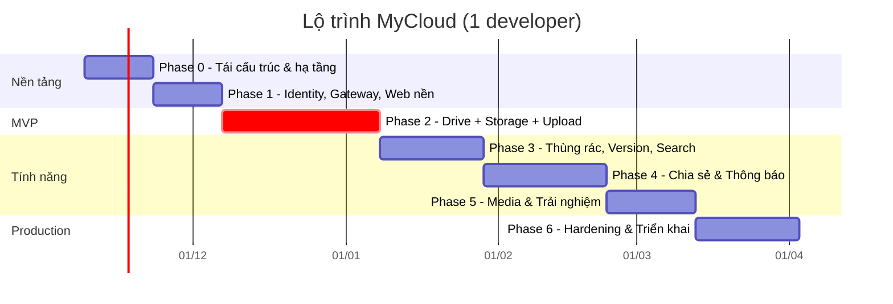

# 07 — Kế hoạch thực hiện

## 1. Nguyên tắc lập kế hoạch

1. **Sửa nền trước, mở rộng sau**: xác thực, quyền sở hữu, lưu trữ file là lõi — làm đúng trước khi thêm tính năng.
2. **Mỗi phase kết thúc bằng một bản chạy được end-to-end** (backend + frontend + test), không làm "hết backend rồi mới làm frontend".
3. **Tái sử dụng code cũ có chọn lọc** (bảng mapping ở mục 4) — không viết lại những gì đang tốt.
4. Làm trên nhánh, merge qua PR có CI xanh.

Ước lượng tính cho **1 developer full-time**: tổng ≈ 20 tuần (≈ 5 tháng), MVP sau ≈ 8–9 tuần. Với 2–3 người, từ Phase 2 có thể chạy song song (Drive / Storage / Frontend) và rút còn ≈ 3 tháng.

## 2. Lộ trình tổng quan

| Mốc | Sau phase | Ý nghĩa |
|---|---|---|
| **M1 — MVP** | 2 | Đăng ký, đăng nhập, cây thư mục, upload file lớn (resume), tải về; dữ liệu cách ly theo user |
| **M2 — Beta** | 4 | Thùng rác, version, tìm kiếm, gần đây, chia sẻ (user + link), thông báo |
| **M3 — Production** | 6 | Thumbnail/preview, quan sát, bảo mật đã rà soát, triển khai K8s/VPS, backup |

---

## Phase 0 — Tái cấu trúc & hạ tầng (≈ 2 tuần)

**Mục tiêu**: repo sạch, chạy toàn bộ hạ tầng bằng 1 lệnh, CI hoạt động.

- [x] Cài .NET 10 SDK; tạo `global.json`; nâng mọi project lên `net10.0`.
- [x] `Directory.Build.props` (Nullable, ImplicitUsings, `TreatWarningsAsErrors`), `Directory.Packages.props` (Central Package Management); ghim MassTransit 8.5.x, MediatR 12.5.x; bỏ AutoMapper, Quartz, Newtonsoft, Swashbuckle, Serilog (log đi qua OpenTelemetry).
- [x] Tạo `MyCloud.slnx` theo cấu trúc ở [02 §8](02-kien-truc-tong-the.md#8-cấu-trúc-thư-mục-mục-tiêu); đổi tên project/namespace, sửa lỗi chính tả (`BuidingBlock` → `BuildingBlocks`...). Command → **Drive** (4 project), Query → **Search** (1 project), Auth → **Identity.Api** (1 project, tách ở Phase 1).
- [x] Tách BuildingBlocks: `Domain`, `Application` (pipeline Performance → Validation → UnitOfWork), `Messaging`, `Grpc` (interceptor map lỗi, deadline), `Web` (ProblemDetails, versioning, OpenAPI + Scalar, Carter).
- [x] `MyCloud.Contracts.Events` (không phụ thuộc gì) và `Contracts/Protos` (thư mục `.proto` + `buf.yaml`, không phải csproj — service link file proto trực tiếp).
- [x] Aspire `AppHost` + `ServiceDefaults` (OTel, health `/health/live|ready`, resilience, service discovery). Postgres, Mongo, RabbitMQ, Redis, MinIO, Mailpit. *(Mongo replica set để Phase 3 khi cần transaction.)*
- [x] `deploy/docker-compose.yml` cho hạ tầng *(image service để Phase 6)*.
- [x] Chuyển EF Core sang **PostgreSQL** (Npgsql, snake_case), mỗi service 1 database, xoá migration SQL Server cũ, tạo migration mới.
- [x] Gỡ toàn bộ secret khỏi `appsettings*.json`; khoá JWT tạm thời do Aspire sinh + lưu user-secrets; gitleaks chạy trong CI. **Khoá cũ đã nằm trong lịch sử git — coi như lộ.**
- [x] Thay outbox tự viết (Quartz) bằng **MassTransit EF Core Outbox** (Drive, Identity); bỏ `TypeNameHandling`, dùng serializer mặc định.
- [x] Test projects: `Drive.Domain.Tests`, `Drive.IntegrationTests` (Testcontainers + MassTransit test harness), `Architecture.Tests` (NetArchTest + kiểm tra không tham chiếu chéo service).
- [x] GitHub Actions `backend-ci.yml`: build + test + `dotnet format --verify-no-changes` + vulnerable packages + `buf lint/breaking` + gitleaks.
- [x] `README.md` gốc và `BackEnd/README.md`: cách chạy, cấu trúc.

Sửa thêm trong Phase 0 (vì code được chuyển sang cấu trúc mới): bug `Register` (S8), lỗi đăng nhập lộ user (S9), `UpdateFile` xoá liên kết nội dung (S6), 500 khi id không tồn tại (S7), xoá thư mục bỏ mặc con (S10 — tạm chặn xoá thư mục không rỗng), audit `CreatedBy = Guid.NewGuid()` (S2, giờ lấy từ `ICurrentUser`), poll outbox 10.000 lần/s (R1), projection không idempotent/sai thứ tự (R3, R5), đường dẫn lưu file hard-code (S5 — tạm lưu ổ đĩa theo cấu hình đến Phase 2), CORS `*`.

**Hoàn thành khi**: `dotnet run --project src/Aspire/MyCloud.AppHost` khởi động mọi container + service khung, dashboard xanh; CI xanh trên PR; `git grep SecretKey` không còn giá trị thật.

---

## Phase 1 — Identity, Gateway, Web nền (≈ 2 tuần)

**Backend**
- [x] Identity: register / login / refresh (rotation + phát hiện reuse) / logout / `users/me` (GET, PATCH) / đổi mật khẩu (thu hồi mọi phiên). Thông báo lỗi đăng nhập không lộ user.
- [x] Rút gọn `AppUser` (bỏ trường HR), thêm `DisplayName`, `AvatarUrl` *(làm từ Phase 0)*.
- [x] JWT **RS256** + `/.well-known/openid-configuration` + `/.well-known/jwks.json`; xoay vòng khoá tự động (ADR-012).
- [x] Publish `UserRegistered`, `UserProfileChanged` qua outbox.
- [x] `BuildingBlocks.Authentication` (mới): JWT bearer lấy khoá từ JWKS qua service discovery, **fallback policy yêu cầu đăng nhập** cho mọi endpoint. `BuildingBlocks.Web` dùng lại; thêm `ICurrentUser.GetRequiredUserId()`.
- [x] Gateway: xác thực theo route (`/auth/*` ẩn danh), rate limit (login/register 5/phút/IP, refresh/logout 30/phút/IP, API 100 req/s/user), `X-Correlation-Id`, xoá header nội bộ (`X-User-Id`, `X-Internal-*`), body tối đa 1 MB.
- [x] Drive + Search: dữ liệu cách ly theo chủ sở hữu (`OwnerId`); item của người khác ⇒ 404. *(Kéo từ Phase 2 lên: bật xác thực mà không lọc theo user sẽ mở lỗ hổng IDOR.)*

**Frontend**
- [x] Tạo `FrontEnd/web`: Vite 6 + React 19 + TypeScript, ESLint, Prettier, Vitest; xoá app CRA cũ `my-drive`.
- [x] Port layout cũ (header, menu điều hướng, nút "Mới") sang TS + MUI; mục chưa làm hiển thị phase sẽ làm.
- [x] Trang đăng nhập / đăng ký / quản lý tài khoản thật; API client tự refresh khi gặp 401 (nhiều request dùng chung một lần refresh); `ProtectedRoute` dựa trên trạng thái thật (khôi phục phiên từ cookie khi tải trang).
- [x] TanStack Query; "Drive của tôi" bản tối thiểu (liệt kê, mở thư mục, tạo thư mục).
- [x] Aspire chạy cả web (`AddViteApp`); Vite proxy `/api` → Gateway nên SPA và API cùng origin. CI riêng `frontend-ci.yml`.

**Test**: integration Identity (14 test: JWKS, cookie, trùng email, sai mật khẩu, lockout, refresh rotation, dùng lại token ⇒ thu hồi family, logout, đổi mật khẩu); Drive (IDOR, 401 khi thiếu / sai chữ ký / hết hạn token); Gateway (401, rate limit 429, correlation id); frontend 22 test (Vitest).

**Lệch so với kế hoạch**
- gRPC `UserService` và `GET /users/lookup`, `/users:batchGet` dời sang **Phase 4**: người gọi duy nhất là Sharing, làm khi có người dùng thật. Nền tảng gRPC (endpoint HTTP/2 riêng) làm ở Phase 2 cùng lời gọi Drive → Storage.
- Identity vẫn là **1 project** (chia thư mục Auth / Users / Tokens / Keys / Data): logic chủ yếu là glue với ASP.NET Core Identity, tách 4 tầng không đem lại gì.
- Node.js trên máy dev là 20.18 (đã hết hỗ trợ 04/2026) nên chọn Vite 6, ESLint 9, React Router 7 thay vì bản mới nhất (cần Node ≥ 20.19 / 22). CI chạy Node 24. **Nên nâng máy dev lên Node 24 LTS** rồi nâng các gói này.

**Hoàn thành khi**: đăng ký + đăng nhập từ web; mọi API không có token → 401; refresh hoạt động sau 15 phút.

---

## Phase 2 — Drive + Storage + Upload/Download → **MVP** (≈ 4–5 tuần)

**Drive service** (thay mô hình Folder/File tạm thời)
- [x] Aggregate `DriveItem` + `FileVersion`, `ItemName` (NFC + không phân biệt hoa thường), materialized path `/{root}/.../{id}/`.
- [x] Schema Postgres + index: unique `(parent_id, name_key)`, `(parent_id, kind, name_key)`, `path text_pattern_ops`, một root mỗi user; `Revision` là concurrency token (lưu đè ⇒ 412).
- [x] Consumer `UserRegistered` → tạo root; `GET /items/root` tạo-nếu-chưa-có (user đăng ký trước Phase 2).
- [x] Tạo thư mục, liệt kê con (thư mục trước, sắp xếp theo tên / sửa đổi / kích thước, phân trang bằng page token), breadcrumb (`/ancestors`), đổi tên (`If-Match`), di chuyển (cập nhật path cả cây con bằng 1 câu UPDATE trong cùng transaction, chặn di chuyển vào con cháu).
- [x] Phân quyền: chỉ chủ sở hữu, qua `IItemAuthorizer` (Phase 4 cắm Sharing vào); item của người khác ⇒ 404.
- [x] Upload: `POST /uploads`, `POST /uploads/{id}/complete` (idempotent), `DELETE /uploads/{id}`; bảng `pending_uploads`; trùng tên ⇒ tự đổi `report (1).pdf`.
- [x] Download: `POST /items/{id}/download-url` → presigned GET 5 phút, `Content-Disposition` giữ tên tiếng Việt (RFC 6266).
- [x] Publish `ItemCreated`, `ItemRenamed`, `ItemMoved`, `FileVersionAdded` (có `Revision`, `AncestorIds`).

**Storage service**
- [x] Client S3 chuẩn (AWSSDK.S3 v4), tạo bucket khi khởi động, bucket private, rule lifecycle abort multipart sau 7 ngày (best-effort).
- [x] Bảng `blobs`, `quotas`; giữ chỗ / ghi nhận / trả quota bằng UPDATE có điều kiện (atomic), cùng transaction với trạng thái blob.
- [x] gRPC `StorageService` (CreateUploadSession, SignUploadParts, CompleteUpload, AbortUpload, GetDownloadUrl, GetQuota) — kiểm tra kích thước thật sau upload (khai nhỏ upload lớn ⇒ xoá, trả quota).
- [x] REST `GET /uploads/{id}/parts` (resume), `POST /uploads/{id}/part-urls`, `GET /quota`.
- [x] Consumer `UserRegistered` (quota), `FileVersionAdded` (claim).
- [x] Job: hết hạn upload session, GC blob không được claim sau 24 h.

**gRPC nền tảng**
- [x] `BuildingBlocks.Grpc`: deadline mặc định, chuyển tiếp JWT của người dùng, không retry tự động ở tầng HTTP, mã lỗi nghiệp vụ đi trong trailer `x-error-code`; endpoint Kestrel HTTP/2 riêng (`grpc`) phân giải qua service discovery `http://_grpc.storage`.

**Frontend**
- [x] Trang "Drive của tôi": dạng danh sách / lưới, breadcrumb, sắp xếp, chọn nhiều (Ctrl/⌘ + click, checkbox).
- [x] Tạo thư mục, đổi tên, di chuyển (hộp thoại duyệt cây), menu chuột phải.
- [x] Upload multipart song song, kéo thả, bảng tiến độ, huỷ / thử lại, tự tiếp tục khi có mạng lại, ký lại URL hết hạn.
- [x] Tải xuống; thanh dung lượng + trang Bộ nhớ.

**Test**
- [x] Domain tests cho `DriveItem`, `ItemName` (27).
- [x] Integration Drive (19): cây thư mục, phân trang, 412 `If-Match`, di chuyển cả cây con, upload idempotent, đổi tên khi trùng, quota, **IDOR** (11 thao tác của user B trên dữ liệu A ⇒ 404).
- [x] Integration Storage với **MinIO thật** (9): upload 2 part qua presigned URL rồi tải về khớp từng byte, vượt quota, sai kích thước, huỷ, resume, chặn user khác, job dọn dẹp + claim.
- [x] Frontend: bộ upload multipart (7 test: song song, thử lại, 403 ⇒ ký lại, mất mạng, huỷ).

**Lệch so với kế hoạch**
- **Upload trình duyệt tự viết thay cho Uppy**: ~200 dòng, khớp thẳng API Drive/Storage, không thêm thư viện; resume trong cùng phiên (mất mạng / lỗi tạm thời). Resume sau khi tải lại trang chưa làm (API `GET /uploads/{id}/parts` đã có sẵn).
- **Presigned URL ký theo origin của trình duyệt** và object storage được proxy cùng origin (`/mycloud-blobs/` qua Vite / nginx) — không cần CORS, chạy được qua localhost, `mycloud.localhost` và IP trong LAN (ADR-013).
- `upload_sessions` gộp vào `blobs` (1 session ↔ 1 blob, cùng vòng đời).
- Đường dẫn dùng `/uploads/{id}/complete`, `/items/{id}/move`, `/items/{id}/download-url` thay cho kiểu `:complete` (route template ASP.NET không hỗ trợ tốt dấu `:` sau tham số).
- Page token hiện mã hoá vị trí (offset) — vẫn là chuỗi mờ với client, đổi sang keyset sau mà không đổi API.
- `CopyBlob` dời sang Phase 3 (cùng chức năng sao chép); xoá / thùng rác ở Phase 3 như kế hoạch.
- Search chuyển sang chiếu `Item*` event, kèm tìm theo tên đơn giản (`GET /search?q=`).
- Dữ liệu Folder/File của Phase 0–1 (chỉ ở dev) không được chuyển đổi — migration xoá bảng cũ.

**Hoàn thành khi (MVP)**: upload file 1 GB, ngắt mạng giữa chừng vẫn resume được; tạo/di chuyển/đổi tên thư mục; tải về đúng tên file; hai user hoàn toàn cách ly dữ liệu; trace một lần upload xem được trọn vẹn trên dashboard.

---

## Phase 3 — Thùng rác, Version, Gắn sao, Search (≈ 3 tuần)

**Drive**
- [ ] Trash / restore (cả cây con, khôi phục về root nếu cha đã mất) / xoá vĩnh viễn / dọn thùng rác; job purge 30 ngày; event `ItemTrashed`, `ItemRestored`, `ItemsPurged` (theo lô).
- [ ] Version: upload đè tạo version mới, liệt kê, khôi phục; giới hạn số version giữ lại (cấu hình).
- [ ] Sao chép file (`CopyBlob`) và thư mục (job nền).
- [ ] Gắn sao, `GET /starred`. Event `ItemAccessed` (gộp 5 phút).

**Storage**: consumer `ItemsPurged` → xoá object + trả quota (idempotent).

**Search service** (tái định hướng từ `MyDrive.Query.*`)
- [ ] Đổi tên, giữ lại `MongoRepository` (sửa: `MongoClient` singleton, bỏ `Task.Run`, `await` đầy đủ).
- [ ] Read model `search_items`, `recent`, `activity`; consumer cho các event của Drive, áp dụng theo `Revision`; idempotency bằng outbox/inbox Mongo.
- [ ] `GET /search` (tên, loại, ngày, chủ sở hữu), `/recent`, `/items/{id}/activity`.

**Frontend**: trang Thùng rác, Có gắn dấu sao, Gần đây; ô tìm kiếm + bộ lọc; panel chi tiết (thông tin, hoạt động, version).

**Hoàn thành khi**: xoá thư mục 1.000 file → khôi phục đầy đủ; xoá vĩnh viễn → object trong MinIO biến mất và quota giảm; tìm thấy file vừa upload trong < 2 s.

---

## Phase 4 — Chia sẻ & Thông báo (≈ 3–4 tuần)

**Sharing service**
- [ ] OpenFGA: container, store, authorization model (xem [03 §5](03-dac-ta-service.md#5-sharing-service)), migration model trong CI.
- [ ] Consumer `ItemCreated` / `ItemMoved` / `ItemsPurged` → tuple; `fga_tuple_outbox` + worker đảm bảo DB và OpenFGA nhất quán.
- [ ] REST quyền: liệt kê (kèm quyền kế thừa), thêm theo email (gRPC Identity), đổi vai trò, thu hồi.
- [ ] Link chia sẻ: tạo / tắt / truy cập anonymous; mật khẩu & hạn dùng.
- [ ] gRPC `AuthorizationService` (Check, BatchCheck với contextual tuples tổ tiên, GetEffectiveRole).

**Drive**: `IItemAuthorizer` = fast-path chủ sở hữu → Sharing; trả `capabilities` cho từng item; hỗ trợ `X-Share-Token`.

**Search**: `access_grants`, `GET /shared-with-me`, lọc kết quả tìm kiếm theo quyền + `BatchCheck` xác nhận.

**Notification service**
- [ ] Lưu liên hệ từ `UserRegistered`; email qua SMTP (Mailpit dev) cho `ItemShared`, `QuotaThresholdReached`.
- [ ] Thông báo in-app + SignalR hub (Gateway proxy WebSocket, Redis backplane).

**Frontend**: hộp thoại chia sẻ (thêm người, vai trò, link), trang "Được chia sẻ với tôi", trang mở link công khai, chuông thông báo realtime.

**Test**: **ma trận quyền** (owner/editor/commenter/viewer/không quyền × xem/sửa/xoá/chia sẻ × trực tiếp/kế thừa/qua link) chạy tự động.

**Hoàn thành khi**: A chia sẻ thư mục cho B quyền xem → B nhận thông báo realtime, thấy thư mục và mọi file con, không sửa được; A thu hồi → B mất quyền ngay lập tức.

---

## Phase 5 — Media & Trải nghiệm (≈ 2–3 tuần)

- [ ] Media Worker: thumbnail ảnh, khung hình video (ffmpeg), trang đầu PDF; `ThumbnailGenerated` → Drive.
- [ ] Xem trước trên web: ảnh (lightbox), PDF (PDF.js), video/audio (presigned `inline`), text/code.
- [ ] Tải nhiều item / cả thư mục dạng zip (job nền stream vào MinIO, thông báo khi xong).
- [ ] Upload cả thư mục (giữ cấu trúc), xử lý xung đột tên hàng loạt.
- [ ] Trang "Bộ nhớ": dung lượng theo loại file, file lớn nhất.
- [ ] (Tuỳ chọn) ClamAV + `MalwareDetected`.

---

## Phase 6 — Hardening & Triển khai (≈ 3 tuần)

- [ ] Stack quan sát production (Prometheus, Grafana, Tempo, Loki), dashboard + cảnh báo ở [06 §4](06-ha-tang-bao-mat-van-hanh.md#4-quan-sát-observability).
- [ ] Rà soát bảo mật theo OWASP ASVS L2; OWASP ZAP baseline; CSP; Trivy; xoay khoá JWT.
- [ ] Load test k6 (liệt kê thư mục 10k item, 200 upload đồng thời), tối ưu index/truy vấn.
- [ ] Helm chart, môi trường staging, pipeline deploy, migration job.
- [ ] Backup/restore đã diễn tập (Postgres, Mongo, MinIO); runbook sự cố (queue `_error`, outbox tồn đọng, MinIO đầy).
- [ ] Identity bổ sung: xác minh email, quên mật khẩu, (tuỳ chọn) đăng nhập Google, 2FA.

---

## 3. Việc làm ngay tuần đầu

1. Cài .NET 10 SDK, tạo nhánh `feature/restructure`.
2. Tạo `Directory.Build.props`, `Directory.Packages.props`, `global.json`.
3. Tạo Aspire AppHost với Postgres/RabbitMQ/Redis/MinIO/Mongo — chạy được hạ tầng trước khi đụng code service.
4. Tách `BuildingBlocks.Domain` + `Contracts.Events` từ `MyDrive.BuidingBlock.Contract`.
5. Chuyển Identity sang Postgres + sửa bug `Register` — service nhỏ nhất, làm mẫu cho các service sau.

> Không nên vá riêng code Command/Query cũ (upload, delete…) vì sẽ được thay thế ở Phase 2–3. Ngoại lệ: nếu cần chạy demo trước, sửa ngay `TimeSpan.FromMicroseconds(100)` → `FromSeconds(1)` và bug `Register`.

## 4. Mapping code cũ → kiến trúc mới

| Code cũ | Đi đâu | Ghi chú |
|---|---|---|
| `MyDrive.BuidingBlock.Contract/Abstractions/Shared/*` (Result, Error, PagedResult) | `BuildingBlocks.Domain` | Giữ nguyên ý tưởng |
| `.../Abstractions/Messages/*` (ICommand, IQuery, handler) | `BuildingBlocks.Application` | Bỏ `IDomainEvent : ICommand` |
| `.../Services/V1/*/DomainEvent.cs` | `Contracts.Events` | Viết lại thành integration event mới |
| `.../Services/V1/*/Command/Query/Response.cs` | Trong từng service (`Drive.Application`) | Không chia sẻ DTO nội bộ qua Contracts; bỏ `IFormFile` |
| `.../JsonConverters/*` | Bỏ | Dùng System.Text.Json |
| `MyDriver.BuildBlock.FTP` | Bỏ → **Storage service** | |
| `MyDrive.Command.Domain` (AggregateRoot, Entity, ValueObject, exceptions) | `BuildingBlocks.Domain` + `Drive.Domain` | `Folder`/`File` → `DriveItem` |
| `MyDrive.Command.Application/Behaviors/*` | `BuildingBlocks.Application` | Giữ Validation, Performance, Tracing; Transaction → dựa trên outbox |
| `MyDrive.Command.Persistence` | `Drive.Infrastructure` | Interceptor audit: lấy `ICurrentUser` thay `Guid.NewGuid()`; bỏ outbox interceptor tự viết |
| `MyDrive.Command.Infrastructure` (MassTransit, Quartz outbox, observers) | `BuildingBlocks.Messaging` | Bỏ Quartz outbox; giữ observer logging (hoặc thay bằng OTel) |
| `MyDrive.Command.Presentation` + `.Api` | `Drive.Api` | Carter modules, middleware |
| `MyDrive.Query.*` | **Search service** | Repo Mongo giữ + sửa; consumer viết lại theo Revision |
| `Auth.Api` | **Identity service** (4 project) | Giữ Identity + EF config; viết lại token & refresh |
| `ApiGateway` | `MyCloud.Gateway` | Bật JWT, thêm route, rate limit |
| `FrontEnd/my-drive` (CRA) | `FrontEnd/web` (Vite + TS) | Port layout, SCSS, cấu trúc router |

## 5. Rủi ro & cách giảm thiểu

| Rủi ro | Ảnh hưởng | Giảm thiểu |
|---|---|---|
| Phạm vi quá lớn cho 1 người | Không bao giờ xong | Mốc MVP rõ (Phase 2); Phase 5–6 có thể cắt bớt |
| Độ phức tạp microservice (debug phân tán) | Chậm | Aspire dashboard + OTel từ Phase 0; integration test với Testcontainers |
| Eventual consistency gây lỗi UX | Người dùng thấy dữ liệu cũ | Đọc nhất quán từ Drive cho các màn hình chính; Search chỉ cho view chấp nhận trễ; frontend optimistic update |
| OpenFGA là công nghệ mới với nhóm | Chậm Phase 4 | Spike 2 ngày đầu Phase 4; nếu không phù hợp, fallback: bảng ACL + truy vấn theo `path` trong Postgres (ADR-007) |
| Thay đổi license thư viện (.NET OSS) | Chi phí / phải thay thư viện | Ghim major, bọc sau abstraction trong BuildingBlocks (ADR-008) |
| Mất dữ liệu file | Nghiêm trọng | Không bao giờ xoá blob đồng bộ; xoá qua event + GC có độ trễ; MinIO versioning; backup |
| Thay đổi hợp đồng phá service khác | Lỗi runtime | `buf breaking` trong CI; event versioning |
